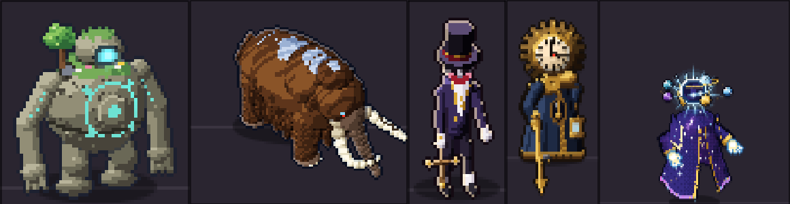
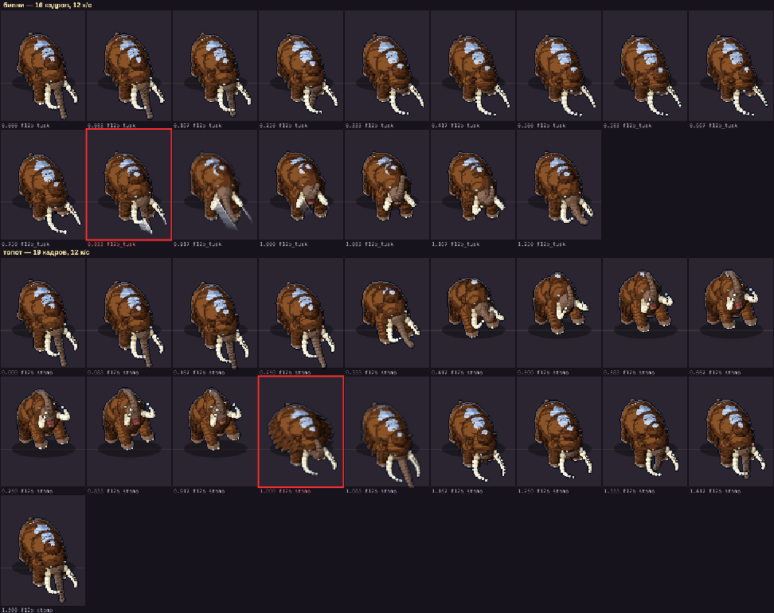
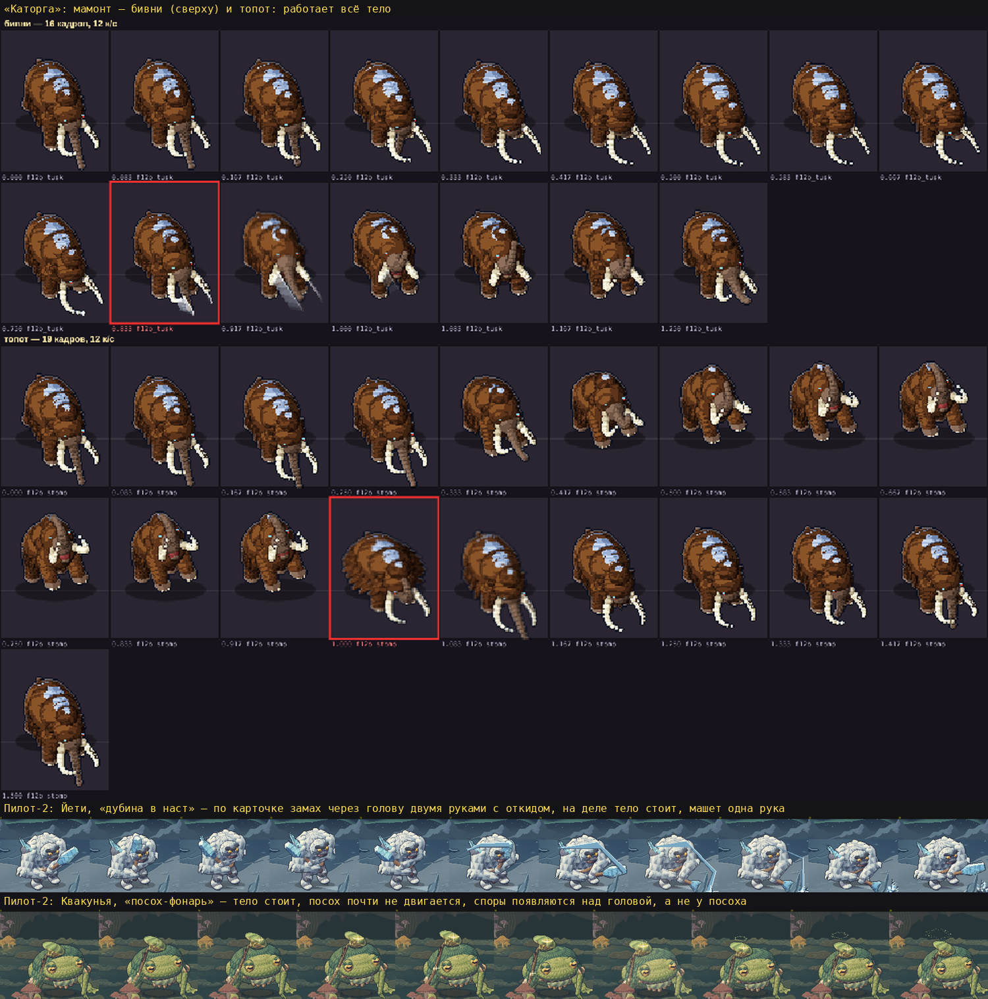
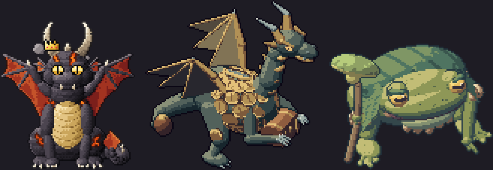

# Пиксельные боссы и живые картины

Эталон — боссы 11–15 из игры владельца «Каторга» (Telegram, репозиторий `SkyTmin/coco-instruments`): Древний страж,
Ледниковый мамонт, Кукловод, Повелитель часа, Хозяин ядра. Каждое наше существо — **босс** этого класса: тот же риг,
тот же свет, те же правила анимации, **несколько разных приёмов со своими эффектами**, и живёт оно **в картине** —
на фоне пола своего уровня, в раме своей редкости.

Слова владельца [18.11]: «Боссы — это у нас шаблон, идеал, всё по ним надо делать, не питомцы». «Все как у боссов!
Боссы эталон! Посмотри на них, какие они красивые, объёмные, все разные». «Я не хочу придумывать велосипед, когда его
уже тогда придумали». «У боссов были анимации разные ударов, эффекты и так далее».

## Порядок работы

1. **Сначала смотри эталон, потом рисуй.** Склонируй `coco-instruments` (только чтение; ветку `prod` не трогать,
   ничего туда не пушить — она сама выкатывается в прод), подними стенд и сними листы покоя и техник пяти боссов
   (§1.4). Держи их рядом всю работу.
2. **Не изобретай.** Риг, наборы приёмов, перо эффектов, частицы, точки тела — переносятся из «Каторги» как есть
   (§1.2, §1.1в, §2.1). Своё пишется только там, где у нас другое: слои картины, фон, рамы, GIF.
3. **Команды по ролям** (§3): Сводящий один на всех делает основу первым; на каждое существо — команда из четырёх
   (Постановщик-Сцена, Тело, Техники, Критик); команды работают одновременно, каждая в своих файлах.
4. **Карточка до кода**: раскадровка всех приёмов по секундам и язык эффектов (§9.0 — образец), у каждого приёма —
   цепочка «кто чем по чему, откуда сила, точка контакта, что происходит, как возврат» (§4.3б); Критик принимает
   карточку, потом начинается «Тело». Приёмы — методом ключевых поз: лист ключей принимается до промежуточных кадров.
5. **Подробности** (§4.0б): после формы — отдельный проход фактуры и мелочей; числа §7.1в зелёные.
6. **Картина** (§8): существо **гуляет по картине** (`life`, §8.7), фон уровня темы с тремя планами, рама редкости
   на общем шаблоне, слои отдельно, GIF — склейка.
7. **Критик не автор**: оценки 1–5 в одном масштабе с эталоном, круги до ≥ 4,5 по §7.2; общий Критик — §7.2б.
8. Грабли и находки — в `references/lessons.md`.

## Где что

| § | Файл | О чём |
|---|---|---|
| 1 | `references/1-katorga.md` | как нарисованы пять боссов, их техники и эффекты, что переносить, как смотреть на стенде |
| 2 | `references/2-pipeline.md` | код `tools/creatures/`, ракурс, размеры, список анимаций, приёмы по редкости, выходные файлы |
| 3 | `references/3-team.md` | Сводящий, команды по 4 агента, параллельная работа |
| 4–6 | `references/4-style.md` | босс, а не питомец; силуэт, свет, палитра, контур; правила анимации; сложность по редкости; вылупление и шоу |
| 7 | `references/7-checks.md` | тесты, чек-лист критика существа и партии, отчёт |
| 8 | `references/8-painting.md` | живая картина: слои, размеры, фон-«этаж уровня», рамы по редкости, анимации картины |
| 9 | `references/9-catalog.md` | пилот из семи с полными карточками, каталог 44 существ в десяти темах + секретные |
| L | `references/lessons.md` | грабли (дописываются) |

## Нельзя

- Упрощать до «питомца»: пропорции, ракурс, характер — как у боссов 11–15 (§4.0).
- Существо, которое стоит в одной точке картины или шагает на месте (§8.7).
- Приём, в котором тело стоит, а машет одна рука; эффект не в точке контакта; след не на пути оружия (§4.3б, §7.1г).
- Гладкий «пластик»: большие пятна одного цвета, мало тонов, нет фактуры (§4.0б, §7.1в).
- Кадры и GIF в git (§2.5).
- Один удар в разных цветах вместо разных приёмов; контакт без следа в мире (§2.4, §7.2).
- Разный размер пикселя в одной картине; фон ярче существа (§8.2, §8.3).
- Радугу, кровь, чужие имена и рисунки; сторонние ассеты из `coco-instruments` (Kenney, 0x72, Ninja Adventure,
  game-icons) (§4.4).
- `Math.random` и текущее время в рисовании: всё детерминировано (§7.1).
- Записывать в отчёт проверку, которой не было; владелец смотрит GIF сам.
