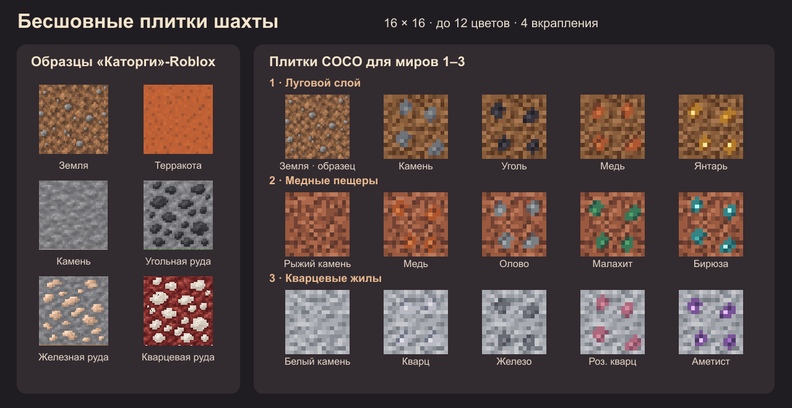

# Этап 3в. Лист текстур до загрузки

Слева — готовые плитки из `coco-prison-roblox`, справа — 14 новых плиток и исходная земля первого мира.
[Источник образцов на `stage-1`](https://github.com/SkyTmin/coco-prison-roblox/tree/3d7ba53c690cf7059df7930d3fa0b09dc3d32c0a/assets/textures/blocks)

У новых плиток 16×16 логических пикселей. Скрипт проверяет совпадение противоположных краёв и палитру до 12 цветов.
Вкрапления используют породу своего мира. Для светлого камня третьего мира взята фактура цельного камня.
