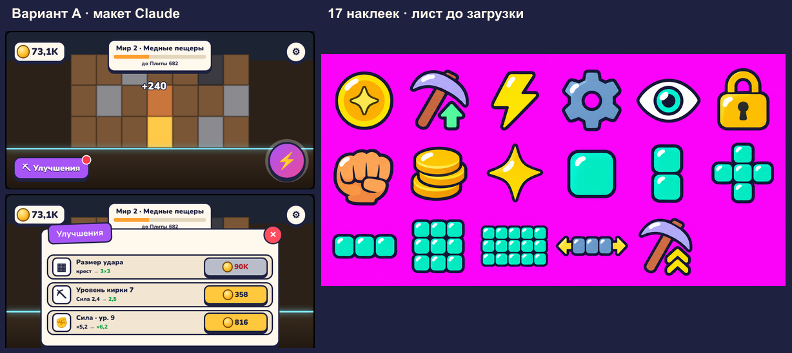
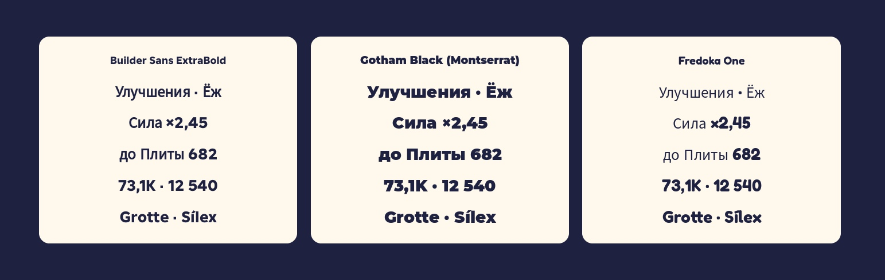

# Этап 3г. Лист до загрузки

Слева — вариант A «Конфета» из макета Claude. Справа — 17 наклеек для интерфейса. Лист создан встроенным генератором
изображений с запросом на сетку 6×3, фон `#FF00FF`, контур `#1E2140` и белый блик. Ряды идут в порядке ТЗ, от монеты
до уровня кирки. При сборке атласа фон снят, наклейки разложены по ячейкам 96×96. [Вариант A](../../design/mockups/ui-styles-2026-11-10.html)

В Studio сравнили Builder Sans ExtraBold, Gotham Black и Fredoka One на строках с «Ё», кириллицей, цифрами и акцентами.
Выбрали Gotham Black (Montserrat) за жирную кириллицу и цифры одинаковой насыщенности. У Fredoka One кириллица
показывается более тонкой заменой. [Семейства шрифтов Roblox](https://create.roblox.com/docs/reference/engine/enums/Font)

