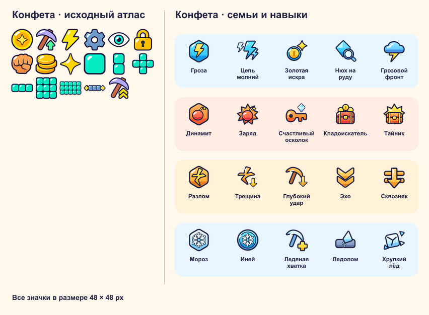
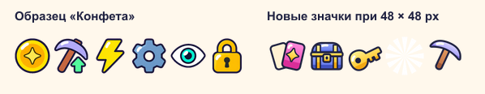

# Этап 4 — семьи и кирки

11.11.2026. В `stage-04` влит актуальный `main` `9d099f8` с заданием на финальные иконки семей и навыков.
Контрольный Play Solo проведён в плейсе `87020443315503`. Визуальная приёмка остаётся за владельцем, ревью — за Claude.

## Проверки и окружение

Итоговый прогон выполнен на Windows, Node.js `24.15.0`. Первый прогон на Steam Deck использовал следующие инструменты.

- Node.js LTS `v26.13.0`: официальный `node-v26.13.0-linux-x64.tar.xz`, распакован в `~/.local/node`.
  SHA-256 сверена с [официальной суммой](https://nodejs.org/dist/v26.13.0/SHASUMS256.txt):
  `d28a96af6c38596f6d9d97c0ee531c13d238d757742387d1928de822d959e997`.
  `~/.local/node/bin` добавлен в `~/.bashrc`.
- Rokit `1.2.0`: официальный установщик `rojo-rbx/rokit`, каталог `~/.rokit`, затем `rokit install` в репозитории.
- Закреплённые версии: Rojo `7.7.1`, StyLua `2.6.0`, Selene `0.32.0`, Lune `0.10.4`.
- `~/.local/bin/gh auth status`: действующая авторизация `SkyTmin` уже была, новый вход не потребовался.

| Команда | Результат |
|---|---|
| `node scripts/build-configs.mjs` | 15 секций и дерево материалов, код 0 |
| `stylua --check src tests` | код 0 |
| `selene src` | 0 errors, 0 warnings, 0 parse errors |
| `rojo build -o build/game.rbxl` | сборка создана |
| `lune run tests` | **138 passed, 0 failed (36 spec files)** |
| `node scripts/simulate-economy.mjs 60` | 8 прогонов, код 0 |
| `git diff --check` | код 0 |

[Полный вывод Lune](TESTS.txt) · [Окружение, размер сборки и замеры](CHECKS.txt)

## §1. Данные

Из `balance/data.mjs` генерируются четыре семьи, их магазинные цены и миры, 16 кирок и деревянная, параметры фишек,
ульт и 16 навыков. Правила ключей и обоих сундуков также приходят из баланса. Золото — флаг экземпляра, Сила ×1,5,
максимальный уровень +10. Цена навыка: `100000 * 10^level`, уровни 0–9 перед покупкой; открытие навыков 0/3/8/15.
`plain_*` удалены из игровых конфигов, Creative, строк и расписания симулятора; название осталось только в миграции.
Сохранены параметры `storm_common.storm` для прежних проверок.

## §2. Профиль

Профиль v3 переносит v1/v2, коллекцию существующей Грозы и доказательство владения из её сохранённого уровня.
Монеты, настройки, круг и шахта v2 сохраняются; временные `plain_*` заменяются деревянной. Добавлены коллекция,
семья, `nextFamily`, постоянные навыки, ключи и накопитель, гарантии, постановочные награды, UTC-день смены и счётчики.
Повреждённые поля отклоняются, навыки при сбросе круга и коллекции сохраняются. Для этапа 5 оставлена явная пометка.
Постановочные сундуки сохраняются в необязательном дополнении кодека шахты v2; естественные восстанавливаются по сиду.
На мгновенной загрузке в Studio обнаружилась гонка с назначением площадки. Инициализация шахты теперь запрашивает
площадку, если обработчик входа ещё её не назначил. Добавлен тест, который вызывает загрузку профиля первым.

## §3. Семья

`Family` проверяет владение и принадлежность экипировки, выбирает сильнейший экземпляр с учётом уровня и золота,
считает уровень, открытия, действующие эффекты и постоянный бонус монет. Первую семью задаёт первая Гроза.
Чужие кирки попадают в коллекцию с отметкой следующего круга. Бесплатная смена — один раз за UTC-день; она выбирает
лучшую кирку и очищает отметки выбранной семьи. `Family.change(..., bypassDay)` пригоден для перерождения этапа 5.
Creative явно обходит ограничение семьи и пишет об этом в лог.

## §4. Фишки

`Perks` и `MiningAction` — чистая логика. Случайность определяется сидом и счётчиком принятых ударов.
Цепь, взрыв, трещина и заморозка используют обычную прочность, ограничиваются окном и Плитой, не запускают рекурсию.
Мороз хранит замёрзшие клетки на сервере; флаги и события приходят клиенту. Навык размера увеличивает число целей,
не вероятность. Взрыв и трещина начинаются у выбранной клетки, в том числе глубоко в открытом проходе.

100 000 реальных ударов на однородной стене **для каждой** комбинации; учтены именно сломанные дополнительные блоки:

| Семья | ★ | ★★ | ★★★ | ★★★★ |
|---|---:|---:|---:|---:|
| Гроза | 1,19904 | 2,10186 | 3,59730 | 6,29496 |
| Динамит | 1,20424 | 2,10742 | 3,61280 | 6,10566 |
| Разлом | 1,20282 | 2,10540 | 3,60045 | 5,74770 |
| Мороз | 1,25000 | 2,14275 | 3,66652 | 6,40000 |

Все результаты в допуске ±15 % от 1,2 / 2,1 / 3,6 / 6,3. Шансы и цены не подгонялись.
У легендарного Динамита в области 5×3×2 остаётся до 29 дополнительных клеток, у Разлома 3×8 — до 23: клетка
основного удара уже сломана. Это объясняет небольшое снижение средних, без изменения баланса.
[решение ТЗ-04 §4] У легендарной Грозы четверть целей уходит в следующий слой. Рост навыка может расширять исходную область.

## §5. Ульты

Гроза гарантирует молнию на ударах ещё 5 с плюс навык **после завершения всей ульты**, включая проезд стены.
Динамит умножает монеты блоков и сундуков ульты на 1,5; Разлом оставляет следующий удар на три слоя; Мороз удваивает
урон ульты по Плите после учёта навыка Ледолом и доли оставшихся слоёв. Глубокий удар, Эхо и Тайник действуют.
Эхо создаёт отдельную полноценную волну, не расходует заряд и не вызывает новое Эхо. Клиент ставит её в очередь за первой.
Формула Плиты `15 ударов * доля оставшихся слоёв` и существующая волна/рассыпание сохранены.

## §6. Навыки

`BuySkill(family, index)` обрабатывается `UpgradeService`: типы, активная семья, открытие, деньги, максимум и частота
проверяются сервером. Действуют все 14 полностью доступных навыков и ключевая часть Счастливого осколка.
Нюх на руду хранится с пометкой будущего обновления, часть про яйца также помечена. Любой купленный уровень даёт
постоянный +1 % монет, в том числе у неактивной семьи. Окно показывает пользу до/после и цену.

## §7. Сундуки в стене

Детерминированный слой сундуков накладывается на прежний генератор руды и корректирует его гистограмму, поэтому
сундук не выдаёт одновременно награду руды. Средняя частота — один на 40 слоёв, Кладоискатель её повышает.
Типы 80/15/4,5/0,5 %, цена — средняя цена блока **глубины сундука** ×50/200/1000/5000.
Рукой нужны три попадания независимо от Силы и крита. Монеты выдаются при любом способе разрушения; ключи — только рукой.
Подключены Жадные сундуки и Кладоискатель. Постановочные Гроза и ключ появляются по общему игровому времени 225/900 с;
если первый ключ уничтожен ультой или фишкой, постановка повторяется. Вид сундука передаётся в окне и снимке ульты.
Тесты проверяют частоту, доли, награды в разных мирах, три попадания, сохранение и повтор постановки.

## §8. Ключи

Накопитель сохраняет дробный остаток; базовый ключ — за 8000 ударов. Карточка и Счастливый осколок ускоряют накопление.
Карточка открывается в мире 3, стоит 1000 ×1,3 за уровень, ограничена уровнем 20. Каждый 20-й сундук **рукой** даёт ключ
с уровня 10, с уровня 20 десятая доля выдач удваивается. Случайность удвоения использует постоянный номер выдачи,
поэтому расход кошелька не повторяет случайный бросок. Кошелёк ключей использует значок ключа из атласа «Конфета».
Получение ключа сопровождают тост и тихий звук из существующего атласа.

## §9. Сундук кирок и расхождение ТЗ

Один ключ, бросок, гарантии, коллекция и счётчик изменяются одной синхронной `ProfileService.Mutate`.
Сервер ограничивает открытия интервалом 0,5 с, клиент также подавляет двойное нажатие. Первый сундук — Редкая нужной
семьи, остальные выбирают семьи равновероятно. Окно показывает базовые шансы и оставшиеся открытия до гарантий.

**Отклонение от §9 п. 7.** При базовом шансе 1,5 % и гарантии на 60-м открытии ожидаемая итоговая доля легендарной
составляет `0,015 / (1 − 0,985^60) ≈ 2,5160 %`. Аналогично гарантия на 10-м открытии повышает долю эпической.
Сохранены базовые шансы и обе гарантии. Замеры на 1 000 000 бросков и полных открытий приведены ниже.

| Выборка | Обычная | Редкая | Эпическая | Легендарная |
|---|---:|---:|---:|---:|
| Базовые броски, % | 60,0305 | 29,9823 | 8,4881 | 1,4991 |
| Итог с гарантиями, % | 56,0908 | 28,0036 | 13,3915 | 2,5141 |
| Расчёт с гарантиями, % | 56,0551 | 28,0276 | 13,4013 | 2,5160 |

Тест проверяет базовые доли и равные доли семей с допуском ±0,3 п. п. Итоговые доли редкостей в том же допуске от
независимого расчёта по циклам между легендарными выпадениями. На миллионе полных открытий нарушений гарантий нет.
Итоговые доли выходят за ±0,3 п. п. от базовых, это остаётся расхождением с буквальным критерием ТЗ.

## §10. Магазин, коллекция и окна

В Улучшениях появились вкладки Кирки и Семья; карточек круга четыре, размер удара остаётся выключенным.
Коллекция — деревянная и сетка 4×4: экземпляры, золото, уровень, Сила, отметка следующего круга и действия.
Магазин проверяет мир, баланс и постоянный флаг покупки. Слияние списывает три обычных экземпляра и сохраняет уровень;
взятая кирка становится золотой. При смене на обычный вариант сверхуровень золота сохраняется, действующий уровень ограничен
обычным максимумом. Выбор семьи показывает только принадлежащие семьи и короткую подсказку о каждой.
Магазин доступен один раз и для уже найденной обычной кирки. Магазин и стеновая Гроза показывают тост,
экран открытия запускается из Сундука кирок. Строки навыков подписывают параметр и значения до и после покупки.
Новые строки переведены на en/ru/es/fr, кнопки проверяются на длину ≤12 символов.

## §11. Контракт для визуала Claude

До манифеста используются существующая деревянная модель с цветом семьи, иконка со звёздами, золотая обводка,
цветные кубы и простой результат открытия.

Добавлены 4 значка семей и 16 навыков в стиле «Конфета». На листе обе группы показаны в размере 48×48 px.
У новых ячеек контур `#1E2140`, округлые формы и белый блик. Сверены все двадцать знаков и соответствие навыкам.
Исходные три ряда атласа проверены попиксельно. Новые ряды идут в порядке Гроза, Динамит, Разлом, Мороз.



`assets/pickaxes/manifest.json` необязателен. Формат:

```json
{
  "pickaxes": {
    "storm_common": { "icon": "rbxassetid://123", "model": "StormCommon" }
  },
  "chests": {
    "wall": [
      { "model": "WallWood" }, { "model": "WallSilver" },
      { "model": "WallGold" }, { "model": "WallCrystal" }
    ],
    "pick": { "model": "PickChest" }
  }
}
```

`node scripts/build-configs.mjs` проверяет имена/ID и переносит записи в `Config.art.pickaxes` и `Config.art.chests`.
Для отсутствующих кирок остаются заглушки. Модели — `Model` внутри `Shared.Models`, с `PrimaryPart` или деталью `Grip`.
`PickModel.forPick` использует один путь для руки и первого лица; `ArtModel.mount` крепит модель к логическому кубу сундука.
Размер и размещение принадлежат адаптеру, бизнес-логика не зависит от модели.

Атлас `assets/ui/candy/icons.png` вырос до 576×672 px. Все 20 ключей добавлены в `ICONS` в `Candy.luau`.
Семья видна на карточке круга и в окне выбора. Навыки показываются в ячейках 48×48 при ширине интерфейса 667 px.
Атлас `rbxassetid://113228730616786` загружен через Studio MCP. `ContentProvider:PreloadAsync` вернул `Success`.

Контроллер вызывает `FamilyFx.perk(event)`, `ult(family, event)`, `frozen(cells)`, `chestOpen(result)`.
События идут существующим каналом `events`: `kind=3/4/5`, `type=perk/ult/frozen`, семья, редкость, точки, `gen`,
`delayMs`, `durationMs`; у ульты дополнительно `buffMs` (для Шторма). Точки содержат `x/y/dRel` относительно
старого фасада; контроллер добавляет `event.front` и `event.result` со снимком серверного результата без повторного списка событий.
`frozen(cells)` получает уже абсолютные `x/y/d`. Результат открытия содержит `id`, `family`, `rarity`, `golden`,
`new`, `nextFamily`; профиль уже изменён сервером. Таймеры эффектов читаются из данных события.

## §12. Creative, аналитика и симулятор

Creative: режим Выдать/Взять для любой кирки и золотого варианта, +10 ключей, любая семья, уровни каждого навыка
0–10 по кругу, сброс коллекции/семьи с сохранением навыков, 100 открытий с долями в лог, обе постановки.
Работают события `pick_get` (shop/chest/wall/merge), `chest_open`, `merge`, `skill_buy`, `family_change`, `wall_chest`,
`key_get` (hits/wall). Все изменения профиля на сервере проходят через `Mutate`.

[Симулятор — восемь прогонов по часу](ECONOMY.txt). Он вызывает производственную `MiningAction`, включая реальные фишки,
навыки, сундуки, ключи, покупки и длительность ульты. Для сравнения явно заданы кирки на 3:45 и 15:00, навыки 0/0/0/0
и 3/1/0/0; это QA-ввод, не скрытая выдача в игре. Общий бонус +4 % и эффекты Золотой искры/Ледяной хватки работают.
Из-за срабатываний и закупок конечный кошелёк не является прямой мерой дохода. Баланс ради совпадения времён не менялся.

Длинный прогон обнаружил нулевой урон от округления малого остатка «Трещин» на большой прочности. Он больше не записывается
как повреждение клетки; добавлен регрессионный тест. Для Steam Deck ускорены квоты и гистограмма без изменения генерации:
эквивалентность хеша и 10 000 отрезков с полным перебором проверены. Замеры последнего Lune:
5000 слоёв ×15 дорожек — 3,993 мс (<5), 25000 ×45 — 55,170 мс (<100), 10000 ударов — 182,269 мс (<200).

Перерождения, Кубки, питомцы, яйца, Удача, Лавка и покупки за R$ относятся к следующим этапам.

## Приёмка

1. **Команды.** Перед каждым новым коммитом прошли `stylua --check src tests`, `rojo build -o build/game.rbxl`,
   `lune run tests` и `selene src`. Итоговая сборка занимает 254 694 Б. Полный прогон Lune на Windows — 138/138.
   [Журнал команд](CHECKS.txt) · [Вывод Lune](TESTS.txt)
2. **Тесты ТЗ.** Покрыты конфиги, миграция, правила семьи и цены навыков, сундуки в стене, ключи и слияние.
   Все 16 средних фишек прошли порог ±15 %, наибольшее отклонение — 8,77 % у легендарного Разлома.
   Для миллиона открытий выполнены гарантии, равные доли семей и допуск от расчётных итоговых долей.
   Расхождение итоговых долей с базовыми приведено в §9.
3. **Серверные отказы.** Через игровые RemoteEvent в Play Solo проверены чужая кирка, закрытый навык,
   сундук без ключей, слияние с одним экземпляром, повтор через 0,19 с и вторая смена в те же UTC-сутки.
   Успешные сценарии подтвердили покупку и открытие навыка, слияние и экипировку золотой, первую редкую кирку
   нужной семьи и сохранение уровней после смены. Постановочный серебряный сундук появился на первом слое и выдал
   ключ на третьем принятом ударе.
4. **Отчёт.** Результаты по §1–§12 выше. Обновлён [журнал прогресса](../../PROGRESS.md).
5. **Studio.** Проверка проведена только в плейсе `87020443315503` в Play Solo с тестовым хранилищем в памяти.
   На viewport 902×339 px проверены 20 координат атласа, загрузка видимых значков, целая первая карточка навыка
   и зазор 8,69 px между кошельком монет и ключами. Studio сообщила об отсутствии представлений двух текстур
   трещин предыдущего этапа (`crack_d_3` и `crack_d_6`). Новый атлас загрузился.

Четыре JPEG сделаны захватом Studio, самый большой занимает 117 022 Б при лимите 300 000 Б.
После проверки оставлен режим Edit с итоговой сборкой. Сверены 106 исходников и 162 материала,
временные сценарии удалены. Плейс не публиковался.

- [Семья и навыки](shots/01-family-skills.jpg) · [Коллекция](shots/02-collection.jpg)
- [Выбор семьи](shots/03-family-choice.jpg) · [Первое открытие Сундука кирок](shots/04-pickaxe-chest.jpg)

## 04б — меню карточками

В атласе «Конфета» добавлены карточки, сундук, ключ, лучи результата и значок кирки. Первые семь рядов атласа
сверены попиксельно. На листе исходные и новые значки показаны в размере 48×48 px.


