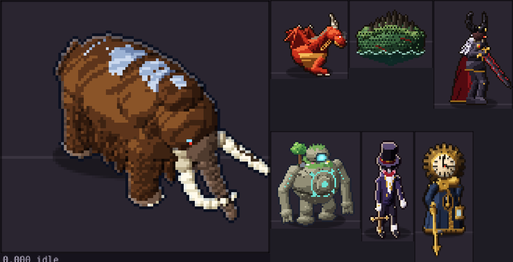

# ТЗ-Б1. Боссы: рисовка и анимация по эталону

Исполнитель — Codex (режим ultra, можно своими агентами). Ветка `bosses-art` от `main`. Писал Claude 18.11 по
просьбе владельца. Правила `AGENTS.md` действуют целиком; этот файл главнее там, где говорит о рисунке.

## 0. Что делаем и почему

[владелец 18.11]: «Боссы — это у нас шаблон, идеал, всё по ним надо делать, не питомцы: питомцы простые, если сравнивать
с боссами. Посмотри, как Клауд их делал, он очень много сил на это тратил… Придумай новых боссов… Не связывай боссов
только с тематикой «шахта»».

[владелец о боссах 12–14 в Telegram-«Каторге»]: «Просто идеально божественно… 12, 13, 14 этажи очень сладкие, очень
вкусные, очень красивые. Эталон!»

[владелец 18.11, когда Claude предложил делать обычных проще]: «Все как у боссов! Боссы эталон! Посмотри на них, какие они
красивые, объёмные, все разные».



Снято Claude 18.11 стендом «Каторги» (`scripts/dungeon/anim-sheet.mjs`, кадр покоя). Вот планка: **взрослые пропорции,
ракурс сверху, объём светом, у каждого свой силуэт и свой предмет, все разные**. Ни одного «милого питомца».

Задача — **конвейер и первые партии 2D-пиксельных существ уровня этих боссов** для Roblox-игры: из яиц, в лагере,
в шахте, в вылуплении. Какую роль существо получит в игре (питомец, помощник за стеклом, босс мира), решается в
концепции отдельно. Рисунок от этого не зависит: **каждое существо — босс**. По виду, пропорциям, ракурсу и характеру. Обычные отличаются
от легендарных размером, числом деталей и сложностью техники, а не стилем: обычный — младший босс той же серии, а не
питомец.

Это фишка игры: живые пиксельные существа в 3D-мире. Поэтому планка — не «нормально», а «не хуже Ледникового мамонта,
Кукловода и Повелителя часа рядом на одном листе».

Не делаем в этом ТЗ: код Roblox (проигрывание, вылупление, яйца), баланс, загрузку картинок в Roblox. Codex отдаёт
PNG-атласы, манифест, листы и видео. Проигрывание в Roblox пишем следующим ТЗ после пилота.

## 1. Эталон: что читать и где (репозиторий `SkyTmin/coco-instruments`, публичный, MIT, автор — владелец)

Клонируй: `git clone --depth 1 https://github.com/SkyTmin/coco-instruments` (ветка по умолчанию `prod`). Код можно
переносить к нам целиком: это работа владельца под MIT. Сторонние части того проекта (Kenney, 0x72, game-icons) не
переносить.

Большие файлы НЕ читать целиком: сначала поиск, потом куски по 100–200 строк.

| Что | Файл | Зачем |
|---|---|---|
| Правила анимации боссов, ошибки и рецепт | `.claude/rules/dungeon-boss-anim.md` — разделы «What made 12–14 the reference», «Reference recipe», «How to staff agents», «Pitfalls and lessons» | главная памятка; всё ниже — её перенос под нас |
| Библия, §14 «Анимация боссов» | `scripts/dungeon/README.md`, строки ~735–854 | эталон темпа: меч и рывок героя; 12 правил |
| Мини-3D риг | `src/lib/dungeon-floors/f12-rig.ts` (678 строк, читать целиком можно) | эллипсоиды, луч на пиксель, буфер глубины, тона, швы, контур |
| Мамонт — образец босса | `src/lib/dungeon-floors/f12-art.ts`: `MamO` ~2505, `mamSkel` ~2626, `mammothBuild` ~2720, `mamAt` (позы по времени, ключи `kf`) ~3201, `mamFrame` ~4133 | как устроена поза из именованных величин, скелет, части, ключи с разгоном и торможением, запаздывание (`t − 0.08`) |
| Кукловод и Повелитель часа | `f13-art.ts`, `f14-art.ts` (по 7 000+ строк — только поиском по имени босса) | реквизит, нити, плащ с инерцией, слой `lit` |
| Риг питомцев без браузера | `src/lib/pets-pixel/rig.ts` (439 строк) | техническая основа для запекания без браузера: чистый TS, тон — номер ступени палитры, `along`, `tex`. **Камеру, пропорции и характер у питомцев НЕ брать** — только у боссов |
| Питомцы-образцы | `src/lib/pets-pixel/phoenix.ts`, `dragon.ts`, `badger.ts` (трюк с решённой геометрией удара), `owl.ts` (свет фонаря поверх тела) | кадр `xxxFrame(anim, i, res, v)`, две полосы `s`/`l`, золотой вариант своей палитрой |
| Запекание | `scripts/pets-pixel/bake.ts`, `post.py` | как кадры превращаются в полосы, обрезка, манифест, `rev` |
| Уроки рисунка | `.claude/rules/pets.md`, раздел «Пиксельные питомцы» и описания каждого питомца (строки «44-px read», «Pitfalls», «Gold») | сотни конкретных ошибок, которые уже исправили: не повторять |

### 1.0. Как посмотреть боссов самому

Стенд «Каторги» работает и без телефона: `npm ci --ignore-scripts`, `npx vite --port 5201 --strictPort`, потом
`PORT=5201 PLAYWRIGHT_MODULE=<путь к playwright/index.mjs> node scripts/dungeon/anim-sheet.mjs spec.json out.png`
(путь к Chromium зашит в скрипте — поправь на свой). Спецификация — в шапке скрипта; `kind` босса — `f6boss` … `f14boss`
(`f12boss` — мамонт, `f13boss` — Кукловод, `f14boss` — Повелитель часа), режим `idle` или режимы техник из `fN-brains.ts`.
**Сними листы техник мамонта, Кукловода и Повелителя часа до начала работы** и держи их рядом: каждое наше существо
сравнивается с ними на одном листе.

### 1.1. Как устроен эталон (коротко, чтобы не искать)

- **Модель — набор эллипсоидов** (`Part`: центр, полуоси, свой поворот, палитра, флаги: мех, блеск, свечение, прозрачность,
  номер для швов). Кадр — **луч на каждый пиксель** с буфером глубины: в пикселе всегда ближайшая часть.
- **Свет один на всё**: сверху-слева-спереди (`LIGHT ≈ [−0.5, 0.42, 0.76]`). Тон — **ступени палитры** (5 тонов от тени к
  блику), без дизеринга, кроме узкой полосы у порога ступени.
- **Шов**: у края ближней части дальняя темнее на ступень. **Кант**: освещённая кромка светлее на ступень. **Контур** —
  по соседу (пиксель на границе силуэта темнеет), цвет контура — не чистый чёрный, а `INK` своей палитры.
- **Слой `lit`**: глаза, руны, огонь, раскалённое — рисуется поверх, в темноте светится.
- **Узор и мех — от локальных координат части**: часть двигается, узор едет с ней, контур не «кипит».
- **Поза — структура именованных величин** (`ph`, `bob`, `pitch`, `jaw`, `ear`, `liftL`…), каждая — функция времени
  через ключи `kf(t, [[t0, v0], [t1, v1, 'i'|'o'] …])` с разгоном/торможением и `bump`. Запаздывающие части — те же
  ключи со сдвигом времени (`t − 0.08`) или пружиной.
- **Геометрия контакта решается, а не подбирается на глаз**: где кирка бьёт в камень, где лапа стоит на полу — считается
  (IK, `hitGeo`, `toBody`). Стопы в опоре не скользят.
- **Детерминизм**: ни `Math.random`, ни текущего времени; разнообразие — фаза из `hash(id)`. Те же числа — те же
  пиксели. Поэтому листы до/после сравниваются попиксельно.

## 2. Что отдаём (формат для Roblox)

### 2.1. Где живёт код

`tools/creatures/` в этом репозитории, TypeScript, запуск `npx tsx` (или `vite-node`), **без браузера**:

- `tools/creatures/rig/` — перенесённый риг (основа — `pets-pixel/rig.ts` + нужное из `f12-rig.ts`). Отвязать от
  `dungeon-*`: свой маленький класс пиксельного буфера, без круговых импортов.
- `tools/creatures/kit/` — общие приёмы: ключи, пружины, IK, `along`, `tex`, `gloss`, `rim`, стандартные эффекты
  (след удара, пыль, искры, кольца, звёздочки) — **рисуются в кадр пикселями**, не частицами Roblox.
- `tools/creatures/c/<id>.ts` — одно существо: палитры, части, скелет, позы, кадр `frame(anim, i, res, variant)`.
- `tools/creatures/index.ts` — реестр.
- `tools/creatures/bake.ts` — запекание: кадры → атласы PNG → манифест; ключи `--id`, `--only anim`, `--res s|l`,
  `--sheet` (листы для просмотра).
- PNG писать чистым JS (`pngjs` или свой кодер). Python не обязателен.

### 2.2. Камера и вид

- Существо в Roblox — плоская картинка, **всегда повёрнутая к камере** (BillboardGui). Поэтому вид один — **как у
  боссов**: камера рига `f12-rig.ts` без изменений (`VIEW = [0, 0.64, 0.77]`, ~40° от вертикали), тело в 3/4 к зрителю
  (угол взгляда ~1,0–1,3 рад, как на снимке выше), не анфас. Объём, «вес» и ракурс сверху — это и есть вид босса;
  анфас с наклоном 15° у питомцев «Каторги» делает их плоскими и милыми — так не надо.
- Влево/вправо — зеркалом в Roblox. Свет при этом НЕ зеркалим: в манифесте флаг `mirrorOk`, если у существа есть
  несимметричная деталь, которая не должна переезжать (шрам, надпись), — тогда печём вторую сторону.
- Правило владельца из «Каторги» в силе: **боком не ходят**. Ходьба — на месте, телом к зрителю, стопы ставятся и
  отрываются по фазе, не скользят.

### 2.3. Два размера — это две полосы, а не масштаб

Рамка зависит от редкости: **размер — первый признак редкости**, как у боссов «Каторги» (мелкая свита и огромный
мамонт).

| Редкость | `s` (мир) | `l` (вылупление, карточка) |
|---|---|---|
| обычный, необычный | 80 × 80 | 128 × 128 |
| редкий, эпический | 112 × 112 | 176 × 176 |
| легендарный, мифический, секретный | 144 × 144 | 224 × 224 |

Существо занимает рамку, а не плавает в ней: тело по большей стороне — 80–90 % рамки (запас под замах и эффекты).

`l` — не увеличенная `s`: модель одна, на крупной — подробности (`HI`): чешуйки, перья, радужка, мягкие переходы тона.
На малой — меньше деталей и шире формы; пропорции те же (голову не увеличивать), глаз — 2×2 с бликом. Так сделаны питомцы, читай
`pets.md` («малая — это не уменьшенная копия»). Числа рамок [решение] — проверим на пилоте.

### 2.4. Набор анимаций

| Анимация | Длина | К/с | Петля | Полоса | Что |
|---|---|---|---|---|---|
| `idle` | 3 с | 12 | да | s, l | характер: дыхание + 2–3 своих жеста (оглядывается, чешется, играет с реквизитом), моргание |
| `move` | 1 с | 12 | да | s | шаг/полёт на месте, к зрителю |
| `happy` | 1–1,2 с | 24 | нет | s, l | радость: на лайк, на хорошую находку |
| `skill` | 2 с | 24 | нет | s | **фирменная техника** — история с подготовкой, ударом, проводкой, возвратом (см. каталог) |
| `strike` | 0,9 с | 24 | нет | s | короткий удар «в стену» вперёд-вниз: замах → контакт → проводка |
| `hatch` | 1,5 с | 24 | нет | l | выход из яйца: из клубка/позы «внутри» — в свою позу с коротким фирменным жестом |
| `sleep` | 3 с | 12 | да | s | сон |
| `show` | 4–6 с | 24 | нет | l | только мифические и секретные: шоу-появление (см. §6.3) |

- Кадр контакта (`skill`, `strike`) указывается в манифесте (`events: [{f: 9, kind: "hit"}]`): по нему Roblox включит
  звук и тряску.
- Разовые анимации **кончаются ровно позой покоя** (кадр 0 `idle`): переход без скачка. Петли **без шва**: разница
  последнего и первого кадра не больше обычного шага между кадрами. Оба правила — тесты (§7).
- 12 к/с для петель — экономия атласов. Считать позы всё равно по времени на 24 к/с и брать каждый второй кадр,
  чтобы при необходимости перепечь петли на 24.

### 2.5. Атласы и манифест

- Атлас — PNG **не больше 1024 × 1024** (Roblox уменьшает картинки крупнее). Кадры одной анимации подряд по строкам.
  Рамка 80 → 144 кадра в атласе, 112 → 81, 144 → 49, 176 → 25, 224 → 16. Число атласов на существо — в отчёт.
- Прозрачный фон, без сглаживания краёв, без премультипликации. В Roblox будет `ResampleMode = Pixelated`.
- Если у существа есть `lit` (светится в темноте), он идёт **отдельным атласом той же раскладки**: в Roblox это второй
  слой без влияния света.
- Золотой вариант (`v1`) — **своя палитра**, не фильтр (как `variants: [1]` у питомцев) плюс пиксельный ореол в 1–2
  кольца. Радужного варианта нет (§4.4).
- Манифест `assets/creatures/manifest.json`, на существо:

```json
{
  "id": "bramble_warden",
  "rev": "<sha1 файлов существа>",
  "rarity": "common",
  "box": { "s": 80, "l": 128 },
  "anchor": { "s": [40, 74], "l": [64, 118] },
  "eye":   { "s": [55, 46], "l": [88, 73] },
  "mirrorOk": true,
  "lit": false,
  "variants": [0, 1],
  "anims": {
    "idle":  { "res": ["s", "l"], "fps": 12, "n": 36, "loop": true },
    "skill": { "res": ["s"], "fps": 24, "n": 48, "loop": false,
               "events": [{ "f": 21, "kind": "hit" }, { "f": 30, "kind": "fx" }] }
  },
  "atlases": [
    { "file": "bramble_warden/s-v0-0.png", "res": "s", "variant": 0, "cells": [["idle", 0, 35], ["move", 0, 11]] }
  ]
}
```

- `anchor` — точка ног (земля) в кадре, `eye` — пиксель глаза в позе покоя (для взгляда и эффектов).
- Отдельно `assets/creatures/<id>/card.json`: имя (ключ строки), редкость, тема, «чтение на 48 px» (3 признака), палитры
  по именам — для коллекции и для проверки.

## 3. Роли агентов (как делал Claude в «Каторге»)

В «Каторге» лучшее вышло, когда работу делили по ролям и **автор не принимал свою работу сам**. Повтори это своими
агентами:

| Роль | Делает | Чего не делает |
|---|---|---|
| **Постановщик** | по каталогу (§9) пишет карточку существа: силуэт, пропорции, части, палитры, «чтение на 48 px», характер покоя, **раскадровку техники с таймингом** (секунда → поза → что видно) | код рига |
| **Тело** | модель: части, скелет, палитры, детали `HI`/`LO`, поза покоя, `idle`, `move`, `sleep`, золотой вариант | эффекты техники |
| **Техники** | `skill`, `strike`, `happy`, `hatch`, `show`: ключи, дуги, след, контакт, пыль/искры/кольца в кадре, кадр удара в манифест | меняет модель только через «Тело» |
| **Сводящий** | общий риг и кит, запекание, атласы, манифест, тесты, вес, листы | рисунок отдельного существа |
| **Критик** | свежий контекст: смотрит листы и видео по чек-листу §7, пишет список расхождений. Сам не правит | не автор этих существ |

- Одно существо — одна пара «Тело» + «Техники» (или один агент на 1–2 простых существа). 3–4 агента одновременно,
  не больше: в «Каторге» семь агентов сразу съели лимит и оборвались вместе.
- **До старта Сводящий даёт общие точки тела** — функции, которые по позе возвращают пиксель руки, пасти, кончика
  оружия, центра груди. «Техники» ставят эффекты по ним, а не по числам на глаз. (В «Каторге» без этого нити Кукловода
  отрывались от руки, луч стража летел из середины спрайта.)
- Коммит `wip(creatures): …` после каждого значимого шага; заметка для передачи в `tools/creatures/NOTES.md`.
- Критик проходит минимум **два круга**; правит автор или новый агент по заметке критика.

## 4. Стиль (обязательные правила)

### 4.0. Это боссы, а не питомцы (главное правило)

- **Пропорции взрослые.** Голова не больше головы у боссов на снимке: у двуногих — 1/5–1/6 роста, у зверей — как у
  настоящего зверя или крупнее не более чем на 20 %. Никаких «большая голова — маленькое тело», огромных глаз-блюдец,
  румянца, пухлых щёк.
- **Масса и стойка.** Широкая постановка ног, вес на земле, плечи и грудь крупнее головы. Даже маленький обычный стоит
  как воин, а не как игрушка.
- **Характер босса**: грозный, величественный, хитрый, древний, гордый — но не «милашка». Для детей без жути, крови и
  уродства (Кукловод и Король демонов на снимке — та самая мера).
- **Свой предмет или своя деталь-знак** у каждого: меч и плащ, цилиндр и трость, часы-голова, дерево на плече. По нему
  существо узнают издали.
- **Все разные**: разные силуэты (высокий, широкий, длинный, парящий), разные тела (зверь, гуманоид, змей, голем, дух),
  разные материалы. Две похожие фигуры в одной партии — брак.
- Юмор допустим деталью (белка в дупле, сапог внутри слизи), но не формой тела.

### 4.1. Силуэт и чтение

- **Чтение на 48 px**: у каждого существа три признака, по которым его узнают, если уменьшить полосу `s` вдвое на
  тёмном и на светлом фоне (у крота — «тёмная груша, розовый пятачок, жёлтая каска»). Признаки записаны в карточке и
  проверяются критиком.
- Силуэт не «шар с глазами»: у каждого — отличительная форма вне овала (рога, уши, хвост, реквизит, панцирь).
- Существа одной темы не похожи друг на друга по силуэту. Существа разных тем не похожи палитрой.

### 4.2. Свет, палитра, контур

- Свет сверху-слева-спереди, один на все существа.
- Палитра существа: 2–4 рампы по 5 тонов (материалы) + **1–2 насыщенных акцента**. Насыщенное — только акцент.
- Тёмное тело получает **холодный кант 1 px** снизу-справа (`coolRim` ворона), иначе тонет в тёмном мире.
- Белое и раскалённое ограничить 5–6-й ступенью: «белое тело — яйцо».
- Контур тёмный своей палитры, одной толщины на всех; внутри силуэта — швы, а не контур.

### 4.3. Анимация (перенос правил §14 библии)

1. Техника — дорожка 24 к/с от времени анимации, кривые с разгоном и торможением, не линейно.
2. **Подготовка → удар → проводка → возврат.** Подготовка читается силуэтом (отвёл, присел, вдохнул). Удар — 2–4 кадра
   со **следом** (дуга цвета металла/стихии поверх пустых пикселей). Проводка — с перелётом за точку удара.
3. **Дуги, а не прямые**: оружие, голова, прыжок.
4. **Запаздывающие части** (хвосты, уши, плащ, цепи, грива, ленты) отстают на 1–3 кадра и доигрывают после остановки,
   с перелётом и затухающим качанием.
5. **Вес**: сжатие перед прыжком и при приземлении, растяжение в полёте. Тяжёлый — медленная подготовка, быстрый удар.
6. **Контакт**: на кадре удара — вспышка 1 кадр, искры/пыль/осколки, которые **живут в мире** (падают, ложатся, гаснут),
   а не «наклейка». Сильный удар — больше, слабый — меньше.
7. **Без «кипения»**: толщина частей и палитра стабильны, контур не прыгает. Промежуточные позы — интерполяцией ключей.
8. Шлейф-силуэты (`ghost`) — только на быстрых ударах.
9. Покой — не «дышит и всё»: свой жест, моргание, взгляд. Разные существа не дышат хором (фаза от `hash(id)`).
10. Реквизит (молот, посох, фонарь) держится руками: точка хвата решается, рука не отрывается.

### 4.4. Решения владельца, которые в силе

- **Радужного цвета нет нигде** [владелец, «Каторга», v2.111: «уберём вообще радужный цвет»]. Мифическое и секретное
  светится цветом своей редкости, «много цветов» — набор из 2–3 цветов, не спектр.
- Врагов-монстров «пока не хочется» [владелец 11.11]: существа — помощники. Сердитые и грозные можно, жуткие и
  кровавые — нет: играют дети.
- Названия и облик — **свои**. Не узнаваемые чужие персонажи, без чужих имён, логотипов и картинок. Мотив может
  прийти откуда угодно (мифы, аниме, сказки), образ — наш.
- Всё по «Каторге»: «владелец замечает наклейку с первого взгляда». Строже, чем хочется.

## 5. Сложность по редкости (бюджет модели и техники)

Все редкости — боссы по виду (§4.0). Разница — размер (§2.3), детали и сложность сцены:

| Редкость | Части | Техника `skill` | Реквизит / свечение | `show` |
|---|---|---|---|---|
| Обычный | 8–14 | одна простая история, 1 эффект | нет / нет | нет |
| Необычный | 12–18 | история + 1 запаздывающая часть с характером | до 1 | нет |
| Редкий | 16–24 | история в 2 такта | 1 / по желанию | нет |
| Эпический | 20–32 | 3 такта, второй персонаж или реквизит участвует | 1–2 / да | нет |
| Легендарный | 28–45 | сцена: смена позы, реквизит, свет, второй план | да / да | нет |
| Мифический | 35–60 | сцена с превращением | да / да | да |
| Секретный | любая | любая | да / да | да, главная |

Вес: стремиться к ~0,5–1,2 МБ PNG на существо со всеми полосами и золотым. Больше — объяснить в отчёте.

## 6. Вылупление и шоу

### 6.1. `hatch` у всех

Яйцо рисует игра (Roblox), не существо. Существо начинает кадром «внутри»: сжатое в клубок или в позе, которая
помещается в овал яйца (центр — `anchor`, рамка яйца ~60 % тела). Дальше — распрямление с весом (сжатие → вытяжение →
лёгкий перелёт) и короткий фирменный жест (рёв, взмах, поклон, искра реквизита). Конец — поза покоя.

### 6.2. Редкость видна по существу, а не только по эффекту игры

Чем реже, тем выразительнее `hatch`: у обычного — потянулся и моргнул; у легендарного — выход с реквизитом, своим
светом и вторым тактом (взлёт, удар об пол, раскрытие крыльев).

### 6.3. `show` (мифические и секретные)

4–6 секунд на полосе `l`, как короткий ролик:
1. **Обман** — первые 0,5–1 с выглядят как обычное появление;
2. **Срыв** — существо замирает, его силуэт тёмный, по нему бегут искры/трещины цвета редкости;
3. **Раскрытие** — превращение или фирменная сцена (у каждого своя, см. каталог);
4. **Поза-представление** — крупно, держится 0,7 с (под надпись имени).
Фон шоу (затемнение, лучи, конфетти) делает игра; в кадре существа — только то, что касается его тела и реквизита.

## 7. Проверки

### 7.1. Тесты (`node --test` или `vitest`, в `tools/creatures/test/`)

- детерминизм: два запекания дают одинаковые байты;
- кадр внутри рамки, ни одного пикселя за краем `box`;
- петли без шва, разовые кончаются покоем (порог — обычный шаг между кадрами);
- стопы в опоре не скользят (у ходячих, по точкам ног);
- кадр `hit` из манифеста совпадает с кадром, где у оружия/лапы контакт (по общей точке тела);
- атлас ≤ 1024, ячейки не перекрываются, манифест ссылается только на существующие файлы;
- палитра: в кадре нет цветов вне рамп существа (кроме ореола золотого и эффектов кита).

### 7.2. Чек-лист критика (на каждое существо)

- узнаётся по трём признакам на 48 px, на тёмном и светлом фоне;
- не похоже силуэтом на соседей своей темы и на существующих боссов/питомцев «Каторги»;
- свет сверху-слева, швы и кант на месте, контур не кипит, узор едет с частью;
- `skill`: подготовка видна, есть дуга, след, проводка, контакт живёт в мире; темп не хуже меча героя «Каторги»;
- запаздывающие части отстают и доигрывают; вес читается;
- покой — с характером, не «просто дышит»; моргание; не дышит хором с соседом;
- `hatch` и `show` начинаются «внутри» и кончаются покоем, обман/срыв/раскрытие читаются;
- золотой — не жёлтая заливка: глубина бронзой, акценты живы, ореол аккуратный;
- рядом с мамонтом/Кукловодом на одном листе — не хуже.

### 7.3. Что прикладывать

- лист каждой анимации ×4 с номерами кадров, кадр удара в красной рамке (`--sheet`);
- MP4 или GIF каждой анимации (s и l), фон: тёмный, средний, светлый;
- общий лист партии: все существа партии в покое кадром 0, полосой `s` в реальном размере и ×2, рядом — мамонт
  (вырежи кадр из листа «Каторги» или срендери их стендом `scripts/dungeon/anim-sheet.mjs`, если поднимешь Vite);
- отчёт партии `docs/reports/creatures/<партия>/REPORT.md`: таблица «существо → части → анимации → кадр удара →
  вес → что не получилось».

## 8. Порядок работ

1. **Сводящий**: риг, кит, запекание, тесты, пустой манифест. Проверка рига: поставить на наш риг части мамонта
   (`mammothBuild` из `f12-art.ts`, поза покоя) и сравнить кадр с листом мамонта со стенда «Каторги» — свет, швы,
   контур и мех должны совпасть до пикселя или с объяснимой разницей (камера та же).
2. **Пилот — три существа** разного устройства: `bramble_warden` (обычный, тяжёлый зверь на четырёх лапах),
   `silk_dragon` (редкий, длинный летун с лентами), `frost_yeti` (эпический, двуногий великан с оружием). Все анимации, обе полосы, золотой.
3. **Стоп.** Claude проверяет пилот в Roblox Studio (атлас, размер на экране с разных дистанций, читаемость, вес),
   владелец смотрит. По итогам правим размеры рамок, наклон камеры, формат манифеста.
4. Партии по 6–8 существ по темам каталога, каждая — с критиком и отчётом. Порядок тем — по каталогу сверху вниз.
5. Секретные — последними, когда кит эффектов устоялся.

Коммиты короткие, по-русски (`feat(creatures): …`, `wip(creatures): …`). Один PR на пилот, дальше PR на партию.
**PR не сливать**: принимает владелец после проверки Claude.

## 9. Каталог существ (новые, не только про шахту)

Темы — десять миров-групп (концепция колец из 50 миров, по 5 миров на группу; окончательное деление — в концепции).
Имена — рабочие, переводы на 4 языка делаются при вводе в игру. Редкость — предложение, баланс решим позже.
**Каждый — босс** (§4.0): ракурс, пропорции и характер как на снимке боссов. Постановщик расширяет запись в карточку
с раскадровкой; облик можно улучшать, но не упрощать и не делать «милее».

Формат: **Имя** (`id`, редкость) — облик и знак; *чтение на 48 px*; покой; **техника** (раскадровка); выход из яйца.

### 9.1. Корни и опушка

1. **Ежевичный страж** (`bramble_warden`, обычный, пилот) — ёж размером с кабана на коротких мощных лапах. Спина —
   панцирь из сплетённых колючих лоз с тёмными ягодами, на морде забрало из коры с прорезями, из-под него горят
   янтарные глаза. *Колючий купол лоз, забрало из коры, янтарные глаза.* Покой: роет землю лапой, лозы на спине
   шевелятся волной, фыркает паром. **Техника**: опускает голову, упирается (0–0,5 с, сжатие) → сворачивается в
   колючее колесо (0,5–0,7) → катится вперёд тараном, за ним след из сорванных листьев (0,7–1,2) → удар: ягоды
   брызгами, щепки, тряска (1,2) → разворачивается, встряхивается (1,4–2). Яйцо: из клубка лоз выпрямляется,
   забрало опускается со щелчком, глаза загораются.
2. **Холм-черепаха Луговой исполин** (`meadow_colossus`, необычный) — огромная черепаха, на панцире холм: трава,
   валуны, кривое деревце. Лапы — как колонны, голова древняя, с наростами. *Холм с деревцем, лапы-колонны, древняя
   голова.* Покой: медленно поворачивает голову, с деревца слетает лист. **Техника**: поднимается на задние лапы
   (медленно, тяжело) → обрушивает передние → трещины по земле, с холма скатываются два валуна → пыль оседает.
   Яйцо: голова и лапы выходят из-под панциря, деревце распрямляется.
3. **Корнерог** (`root_stag`, редкий) — высокий олень с белой гривой на груди, рога — ветвистые корни, на отростках
   висят фонари-светлячки (`lit`). *Корни-рога выше тела, огоньки, белая грива.* Покой: поводит ушами, фонари качаются
   с запаздыванием. **Техника**: встаёт на дыбы → удар копытами → из земли кругом вырываются корни и опадают →
   светлячки срываются с рогов вихрем и возвращаются. Яйцо: поднимает голову, рога разворачиваются, огни загораются по
   одному.
4. **Владыка рощи** (`grove_lord`, легендарный) — древень втрое выше человека: ствол-тело, лицо в коре, борода мха,
   руки-ветви с листвой, в дупле на груди живёт белка (второй персонаж со своей анимацией). *Ствол с кроной, янтарные
   глаза в тени, руки-ветви.* Покой: крона колышется, белка выглядывает. **Техника**: вскидывает руки-ветви (медленно)
   → обрушивает их в землю → волна по земле, сыплются жёлуди → белка выскакивает и швыряет орех вперёд. Яйцо: из
   клубка корней вырастает в рост, белка выпрыгивает последней.

### 9.2. Грибной грот

5. **Мухоморный рыцарь** (`toadstool_knight`, обычный) — воин в доспехе из коры, шлем — красная шляпка в белых пятнах,
   щит — срез шляпки, копьё — стебель. *Красный шлем-шляпка, щит, копьё.* Покой: перехватывает копьё, поправляет щит.
   **Техника**: отводит копьё (подготовка) → выпад с шагом вперёд, след копья → облако спор по дуге → возврат в стойку.
   Яйцо: шляпка-шлем раскрывается, рыцарь салютует копьём.
6. **Светлый Купол** (`glow_jellycap`, редкий) — огромный парящий гриб-медуза, купол светится бирюзой (`lit`), под
   куполом тёмный «лик» с двумя огнями, вниз свисают длинные нити грибницы. *Светящийся купол, нити до земли, два
   огня.* Покой: парит, нити струятся с запаздыванием. **Техника**: купол сжимается ×2 → споры-огни поднимаются и
   выстраиваются кольцом → кольцо падает на землю и вспыхивает. Яйцо: всплывает, нити раскручиваются.
7. **Королева Слизь** (`slime_queen`, эпический) — высокая прозрачная фигура из зелёной слизи (части с `alpha`) в виде
   королевы в мантии, корона из грибов, скипетр; внутри плавают ключ, монета, старый сапог. *Прозрачная фигура в
   короне, скипетр, предметы внутри.* Покой: мантия колышется, предметы кружат. **Техника**: взмах скипетром → делится
   на три стражника-слизи, каждый прыгает вперёд → они сливаются обратно с плюхом, корона подлетает и садится. Яйцо:
   лужа поднимается в фигуру, корона ложится последней.
8. **Жаба-шаман Квакунья** (`toad_shaman`, легендарный) — огромная жаба в мшистом плаще, бусы из раковин, посох с
   грибом-фонарём (`lit`). *Широкая жаба, плащ, посох с огнём.* Покой: раздувает горло, огонь посоха дышит. **Техника**:
   поднимает посох → горло раздувается до шара → «Ква!»: кольца звука из пасти (фиксированная точка рта) → фонарь
   вспыхивает → вокруг вырастают и прячутся грибы. Яйцо: выпрыгивает, ловит посох, ударяет им о землю.

### 9.3. Кристальные гроты

9. **Жук-таран Самоцвет** (`gem_beetle`, необычный) — крупный жук-носорог, рог и надкрылья — гранёный голубой кристалл,
   лапы золотые. *Кристальный рог, гранёный панцирь, блик.* Покой: блик бежит по граням. **Техника**: упирается →
   рог разгорается → бросок вперёд, удар рогом, осколки света → откат. Яйцо: панцирь раскрывается и захлопывается.
10. **Ящер Друз** (`druse_lizard`, редкий) — варан, вдоль спины ряд аметистовых кристаллов, хвост в кристаллах.
    *Фиолетовые шипы, длинный хвост, жёлтые глаза.* Покой: язык, хвост постукивает. **Техника**: хвост замахивается
    дугой → удар об пол → по земле вперёд вырастают кристаллы цепочкой и тают. Яйцо: кристаллы на спине вырастают по
    одному.
11. **Зеркальный страж** (`mirror_owl`, эпический) — огромная сова-идол из зеркальных пластин на каменном насесте,
    глаза — полированные диски. *Пластины-перья, диски-глаза, насест.* Покой: голова поворачивается, отражения едут.
    **Техника**: раскрывает крылья → вспышка → по бокам два белых двойника-силуэта → сливаются обратно. Яйцо: пластины
    раскладываются веером.
12. **Колосс Жеода** (`geode_colossus`, легендарный) — великан из половинок жеод, в груди светится ядро (`lit`), камни
    кружат вокруг. *Плечи-скалы, светящаяся грудь, маленькая голова.* Покой: ядро пульсирует. **Техника**: грудь
    раскрывается → ядро разгорается → луч в землю → кристаллы вздымаются волной → грудь закрывается. Яйцо: груда
    камней собирается в фигуру, ядро зажигается последним.

### 9.4. Глубоководье

13. **Краб-отшельник Котёл** (`kettle_crab`, обычный) — краб размером с бочку, живёт в старом медном шлеме водолаза,
    одна клешня огромная. *Медный шлем-домик, огромная клешня, глаза-стебли.* Покой: щёлкает клешнёй. **Техника**:
    прячется в шлем → из шлема бьёт струя пара → выскакивает и бьёт клешнёй вниз, брызги. Яйцо: выглядывают глаза,
    потом клешня.
14. **Удильщик Бездны** (`abyss_angler`, редкий) — крупная рыба-удильщик, фонарь (`lit`), пасть с рядами зубов
    (не страшно, а грозно), плавники-веера. *Фонарь, большая пасть, тёмное тело с холодным кантом.* Покой: фонарь
    качается с запаздыванием. **Техника**: фонарь гаснет → вспышка → рывок с открытой пастью → стайка рыб
    разлетается. Яйцо: всплывает, фонарь зажигается.
15. **Осьминог-адмирал Чернилус** (`ink_admiral`, эпический) — осьминог в треуголке и мундире, в щупальцах подзорная
    труба, сабля и карта. *Треуголка, щупальца с вещами, большие глаза.* Покой: смотрит в трубу, щупальца каждое в своей
    фазе. **Техника**: разворачивает карту → взмах саблей → чернильная волна ложится на пол линиями маршрута, крестик
    вспыхивает. Яйцо: щупальца раскручиваются, треуголка надевается последней.
16. **Морской змей Прилив** (`tide_serpent`, легендарный) — кольца змея выходят из кольца воды (часть кадра), гребень-
    плавник, длинные усы. *Кольца над водой, гребень, усы.* Покой: кольца перекатываются. **Техника**: нырок →
    выныривает высоко с рёвом → гребень волны обрушивается брызгами. Яйцо: из водяного кольца поднимается голова.

### 9.5. Небесные острова

17. **Грозовой баран** (`storm_ram`, обычный) — горный баран, руно — грозовая туча, рога-спирали с искрами. *Тёмное
    руно-туча, спиральные рога, искры.* Покой: из руна вспыхивают зарницы. **Техника**: отступает, опускает рога → разбег
    → удар рогами, молния в землю, клубы тучи. Яйцо: туча собирается в барана, рога закручиваются.
18. **Шёлковый дракон** (`silk_dragon`, редкий, пилот) — длинный летучий дракон из шёлка и бумаги, как праздничный змей:
    рогатая голова-маска, тело-лента с рёбрами-распорками, по бокам ленты-плавники. *Голова-маска, длинное тело-лента,
    ленты по бокам.* Покой: парит волной, тело и ленты отстают по всей длине. **Техника**: делает петлю (дуга!) → тело
    закручивает ветровую спираль → бросок головой вперёд → выравнивается. Яйцо: разворачивается из сложенного свитка.
19. **Грифон-вестник** (`herald_griffin`, эпический) — величественный грифон в кожаной сбруе с сумкой и печатью.
    *Орлиная голова, широкие крылья, сумка с печатью.* Покой: чистит перо, поправляет сумку. **Техника**: взмах
    крыльями → пикирует вперёд-вниз (шлейф-силуэты) → вихрь писем из сумки и обратно. Яйцо: расправляет крылья, ловит
    падающее письмо клювом.
20. **Небесный кит Алтан** (`sky_whale`, мифический) — огромный кит, на спине остров с маяком (луч маяка — `lit`).
    *Громадное тело, остров с маяком, плавники.* Покой: плывёт, маяк вращает луч. **Техника**: вдох → из дыхала
    фонтан облаков и звёзд → луч маяка обводит круг. **Show**: обман — маленькое облачко; срыв — облачко темнеет,
    искры; выплывает кит во весь рост, маяк вспыхивает, поза.

### 9.6. Песчаные гробницы

21. **Шакал-разведчик** (`dune_jackal`, обычный) — поджарый шакал на задних лапах в платке и наплечнике, с копьём-
    крюком. *Длинные уши, платок, копьё.* Покой: уши ловят звуки. **Техника**: рывок вперёд с пылевым следом → удар
    копьём → торможение с заносом. Яйцо: выпрыгивает из песка, вращает копьё.
22. **Страж-мумия Бинтар** (`wrap_warden`, редкий) — высокий воин в бинтах с кошачьей головой в бинтах, один глаз
    светится, серп-клинок. *Бинты полосами, светящийся глаз, серп.* Покой: конец бинта плывёт. **Техника**: кружится →
    бинты разлетаются лентами по спирали → удар серпом → бинты стягиваются обратно. Яйцо: разматывается из кокона.
23. **Сфинкс Загадка** (`riddle_sphinx`, эпический) — лежащий сфинкс с каменными крыльями и табличкой. *Лежащая поза,
    головной убор, табличка.* Покой: постукивает когтем по табличке. **Техника**: глаза светятся (`lit`) → вокруг
    кружат свои знаки-руны (не египетские иероглифы) → табличка бьёт лучом вперёд. Яйцо: открывает глаза, руны
    загораются.
24. **Скорпион Анкхар** (`sand_scorpion`, легендарный) — огромный золотой скорпион в головном платке, жало — кристалл.
    *Клешни, поднятый хвост, платок.* Покой: хвост покачивается. **Техника**: хвост закидывается дугой → удар вперёд →
    песчаный вихрь → оседает. Яйцо: выкапывается из песчаной горки.

### 9.7. Вулкан

25. **Магмовый червь** (`magma_worm`, обычный) — толстый червь из пластин застывшей лавы, между ними светятся щели
    (`lit`). *Пластины, светящиеся щели, круглая пасть.* Покой: щели пульсируют. **Техника**: поднимается → плюёт
    сгустком лавы по дуге → сгусток остывает камнем. Яйцо: выползает, щели загораются.
26. **Саламандра-кузнец Горнила** (`forge_salamander`, редкий) — мускулистая саламандра в кожаном фартуке, молот и
    наковальня. *Фартук, молот, наковальня.* Покой: стучит молотом по ладони. **Техника**: замах (решённый хват) → удар
    по наковальне → фонтан искр → любуется. Яйцо: появляется с молотом на плече.
27. **Носорог Пепелище** (`ash_rhino`, эпический) — носорог в обсидиановых пластинах, трещины светятся. *Пластины,
    рог, светящиеся трещины.* Покой: роет копытом, пар из ноздрей. **Техника**: разгон на месте → рог загорается →
    удар вперёд со вспышкой и осколками. Яйцо: пластины смыкаются, трещины загораются.
28. **Титан Жерло** (`crater_titan`, мифический) — великан-гора, на голове кратер. *Горбатая гора, кратер, руки-скалы.*
    Покой: дымок из кратера. **Техника**: напрягается → извержение → бомбы лавы по дугам → остывают. **Show**: обман —
    камешек; срыв — трещины света; камешек растёт в гору, кратер взрывается, поза.

### 9.8. Полярная ночь

29. **Пингвин-маршал** (`penguin_marshal`, обычный) — крупный императорский пингвин в шинели с эполетами, ледяная
    сабля. *Шинель, эполеты, сабля.* Покой: гордо поправляет шинель. **Техника**: салют саблей → разбег → скольжение
    на животе с ледяной струёй и ударом саблей. Яйцо: выходит, стряхивает снег, салютует.
30. **Лис Иней** (`frost_fox`, редкий) — белый лис с тремя хвостами, кончики — сияние (бирюза/зелень). *Белый лис,
    три светящихся хвоста.* Покой: хвосты ведут по очереди. **Техника**: прыжок с разворотом → хвосты чертят ленты
    сияния → ленты гаснут снежинками. Яйцо: сворачивается, хвосты загораются.
31. **Йети Буран** (`frost_yeti`, эпический, пилот) — великан-йети в доспехе из льдин, ледяная дубина, на поясе
    связка сосулек. *Белая громада, ледяная дубина, наплечник-льдина.* Покой: дышит паром, перекладывает дубину. **Техника**:
    скатывает дубиной снежный ком (ком растёт) → замах → удар по кому, ком летит вперёд и взрывается снежными осколками
    → бьёт дубиной в грудь, рёв. Яйцо: вырывается из сугроба, рёв.
32. **Дракон Стужа** (`frost_drake`, легендарный) — ледяной дракон с кристальными крыльями. *Крылья-льдинки, гребень,
    голубые глаза.* Покой: пар изо рта. **Техника**: вдох (свет в горле) → морозное дыхание вперёд → ледяные шипы
    вырастают и трескаются. Яйцо: разбивает лёд вокруг себя.

### 9.9. Заводной город

33. **Заводной рыцарь** (`windup_knight`, обычный) — жестяной рыцарь с ключом на спине, копьё-штырь. *Ключ на спине,
    жестяной шлем, копьё.* Покой: ключ медленно вращается. **Техника**: ключ раскручивается → выпад копьём с искрами →
    «щёлк», застывает. Яйцо: ключ поворачивается, глаза-лампы загораются.
34. **Паровой пёс Котёл** (`steam_hound`, редкий) — латунный механический пёс с котлом на спине. *Котёл, латунь,
    поршни-лапы.* Покой: поршни ходят, пар. **Техника**: свисток пара → поршни качают → прыжок вперёд, приземление в
    облаке пара. Яйцо: загорается глаз-лампа.
35. **Богомол Маятник** (`clock_mantis`, эпический) — богомол из деталей часов, руки-стрелки. *Стрелки, циферблат на
    груди, шестерни.* Покой: стрелки тикают. **Техника**: руки-стрелки описывают круг → шестерни облетают его → звон,
    кольцо волны. Яйцо: шестерни встают на места.
36. **Великан Наковальня** (`anvil_giant`, легендарный) — робот с печью в груди и трубой на голове. *Труба с дымом,
    печь в груди, огромные кулаки.* Покой: печь гудит. **Техника**: грудь распахивается, печь ревёт → удар кулаком с
    паровой волной → грудь закрывается. Яйцо: собирается из деталей, печь зажигается.

### 9.10. Звёздная бездна и сны

37. **Лунный страж** (`moon_warden`, необычный) — высокий кролик-воин в лёгком доспехе с глефой-полумесяцем, уши
    прижаты назад. *Длинные уши, глефа-месяц, плащ.* Покой: опирается на глефу, плащ плывёт. **Техника**: вращает глефу
    кругом → удар → след-полумесяц и звёздочки. Яйцо: выпрямляется, глефа ловит лунный блик.
38. **Пантера Созвездие** (`star_panther`, редкий) — тёмно-синяя пантера, на теле звёзды, линии созвездий проступают
    при движении. *Тёмная пантера, светящиеся точки, длинный хвост.* Покой: точки мерцают. **Техника**: припадает →
    прыжок вперёд со следом из звёзд → созвездие вспыхивает. Яйцо: звёзды загораются по одной.
39. **Сова-ведьма Полночь** (`witch_owl`, эпический) — высокая сова в мантии и остроконечной шляпе, посох-метла,
    пояс склянок. *Шляпа, мантия, посох.* Покой: помешивает воздух посохом, искры. **Техника**: вихрь посохом → бросок
    склянки → облако фиолетового дыма с искрами. Яйцо: появляется в дыму, ловит шляпу.
40. **Кальмар Туманность** (`nebula_squid`, мифический) — гигантский кальмар, тело — туманность (`alpha`), щупальца со
    звёздами на кончиках. *Светящееся тело, длинные щупальца, звёзды.* Покой: щупальца струятся. **Техника**:
    раскрывается → спираль затягивает звёзды → вспышка, звёзды разлетаются. **Show**: обман — одна звезда; срыв —
    гаснет; из темноты раскрывается кальмар.

### 9.11. Секретные (вне тем, главное шоу)

41. **Монетный дракон** (`coin_dragon`) — большой дракон, чешуя — монеты, на спине прорезь копилки, в лапах сундук.
    **Show**: игра превращает яйцо в огромную монету → монета раскалывается → дракон вырывается, из прорези сыплется
    дождь монет, поза с монетой в пасти.
42. **Древо-страж** (`world_tree`) — молодое мировое древо на корнях-ногах, крона светится. **Show**: из скорлупы
    вылезает росток → растёт в огромное дерево, заполняя рамку → крона вспыхивает → древо делает шаг вперёд.
43. **Сердце Бури** (`storm_heart`) — дух-молния в фонаре-клетке, который носит в руке великан из грозовых туч.
    **Show**: фонарь дрожит, искры → дверца распахивается, молнии кругом → из туч собирается великан и берёт фонарь.
44. **Зверь Бездна** (`void_beast`) — чёрный лев-зверь, грива — кольцо света, по шкуре звёзды. **Show**: всё
    затягивает внутрь (искры летят к центру) → схлопывается в точку → раскрывается зверь, грива загорается.

## 10. Перенос из «Каторги» (отдельная задача, после пилота)

Боссы подземелья (Крысиный король, Живые доспехи, Алая пасть, Каменный идол, Минотавр, Красный змей, Отражение героя,
Демон семи лун, Многоглавая гидра, Король демонов, Древний страж, Ледниковый мамонт, Кукловод, Повелитель часа, Хозяин
ядра) и 18 пиксельных питомцев — тоже наши. Их модели можно перенести на наш риг и снять нашим набором анимаций (§2.4).
Сначала — только после пилота и с решением владельца, кого берём.

## 11. Сдача пилота

- ветка `bosses-art`, PR «Существа: конвейер и пилот», не сливать;
- `tools/creatures/` с тестами (зелёные), `assets/creatures/` (атласы, манифест), листы и видео в
  `docs/reports/creatures/pilot/`, `REPORT.md` с таблицей и честным списком того, что не получилось;
- круги критика — его заметки в отчёте.
