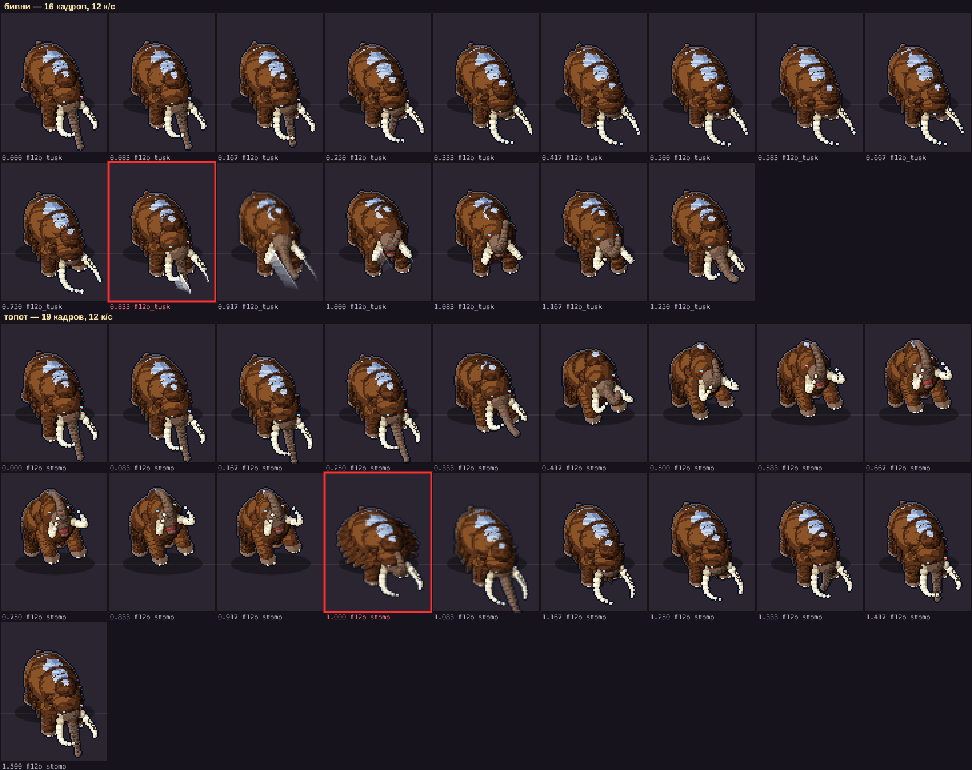

# ТЗ-Б1. Боссы: рисовка и анимация по эталону «Каторги»

Исполнитель — Codex (режим ultra, можно своими агентами). Ветка `bosses-art` от `main`. Писал Claude 18.11 по
просьбе владельца, после разбора кода боссов в `coco-instruments`. Правила `AGENTS.md` действуют целиком; этот файл
главнее там, где говорит о рисунке.

## 0. Что делаем и почему

[владелец 18.11]:
- «Боссы — это у нас шаблон, идеал, всё по ним надо делать, не питомцы».
- «Все как у боссов! Боссы эталон! Посмотри на них, какие они красивые, объёмные, все разные».
- «Эталон — боссы с 11 этажа по 15 этаж».
- «Я хочу, чтобы Codex подготовил гиф-анимации по каждому, в игре как будет выглядеть — посмотрим потом».
- «Я не хочу придумывать велосипед, когда его уже тогда придумали».
- «У боссов были анимации разные ударов, эффекты и так далее».

Снято Claude 18.11 стендом «Каторги» (`scripts/dungeon/anim-sheet.mjs`, кадр покоя, ×3). Вот планка: **взрослые
пропорции, ракурс сверху, объём светом, у каждого свой силуэт и свой предмет, все разные**.

Эталон — это **и тело, и техники**: у каждого босса 5–10 разных приёмов, у каждого приёма своя анимация и свои
эффекты в одном «языке» босса (лёд у мамонта, театр у Кукловода, часы у Повелителя, астролябия у Хозяина). Тело без
техник — половина работы.

**Задача:** новые 2D-пиксельные существа уровня этих пяти боссов — **тем же кодом и теми же приёмами**, которыми
нарисованы они, — и **GIF каждой анимации каждого существа**. Как это встанет в Roblox, решим потом отдельным ТЗ;
сейчас не делаем атласы, загрузку и код игры.

**Каждое существо — босс** по виду, пропорциям, ракурсу и характеру. Обычные отличаются от легендарных размером,
числом деталей и сложностью техники, а не стилем: обычный — младший босс той же серии, а не питомец.

## 1. Не изобретать: что брать готовым из «Каторги»

Репозиторий `SkyTmin/coco-instruments` (публичный, MIT, автор — владелец): `git clone --depth 1
https://github.com/SkyTmin/coco-instruments` (ветка `prod`). Код переносить к нам **как есть**, с пометкой в шапке
файла, откуда он (`// из coco-instruments src/lib/dungeon-floors/f15-rig.ts, prod 523bae1`). Сторонние части того
проекта (Kenney, 0x72, Ninja Adventure, game-icons) не переносить.

Большие файлы (6 000–7 500 строк) НЕ читать целиком: поиск по имени, потом куски по 100–200 строк.

### 1.1. Как нарисованы пять боссов (по коду)

Все пять — **маленький 3D-риг, который считается в пиксели с буфером глубины**, свет сверху-слева, тон ступенями
палитры, контур. Поэтому они объёмные и поворачиваются на любую сторону даром. Отличаются набором примитивов:

| Босс | Файл и место | Как устроен | Что из него брать |
|---|---|---|---|
| **Древний страж** (11) | `f11-art.ts`, раздел «Щитовой пилон и Древний страж» ~3294; холст 116×104 | шар корпуса, голова, руки и ноги на **обратной кинематике** (кисть и стопа — цели, локоть и колено находятся сами); сад, руны, плита ядра, люки, трещины лежат **на поверхности шара в осях тела**; кулаки, ушедшие в пол, срезает земля; на стыке частей тёмная линия | IK-конечности, детали на поверхности тела, срез землёй, фазы облика (купол, раскрытое ядро, трещины) |
| **Ледниковый мамонт** (12) | `f12-rig.ts` (весь, 678 строк) + `f12-art.ts`: `MamO` ~2505, `mamSkel` ~2626, `mammothBuild` ~2720, `mamAt` ~3201, `mamFrame` ~4133; холст 176×160 | эллипсоиды **лучом на пиксель**; 5 тонов, мех прядями, снег пятнами на спине, швы, кант; поза — **структура именованных величин** (`ph`, `bob`, `pitch`, `jaw`, `ear`, `ta`…), каждая — ключи по времени `kf(t, [[t0,v0],[t1,v1,'i'|'o']…])` | мех и материалы, устройство позы, ключи с разгоном/торможением, запаздывание хобота и шерсти сдвигом времени |
| **Кукловод** (13) | `f13-art.ts`: риг кукол ~1983 (капсулы, шары, диски), «Ключи поз с кривыми, пружины, след удара» ~3398 | `mixP` (смесь поз, k вне 0…1 — перелёт), `addP` (добавка поверх живой позы), `track` (поза на треке, кривая у ключа), `F24` (кадр 24 к/с), `spring` (пружина, шаг ≤ 1/120 с), `cropFrame` (обрезка с переносом точки ног) | **трек поз**, пружины вторичного движения, нити и реквизит в руке, плащ с инерцией |
| **Повелитель часа** (14) | `f14-art.ts` ~472 (шапка-описание), риг `LRig`; холст 120×112 | точки в своих осях, камера 3/4 на 16 сторон; техника — ключевые позы на оси времени, вторичное — **пружины 60 Гц по той же позе** (`lSecTrack`: полы, кайма, рукава, маятник, песочные часы, голова и нимб догоняют корпус с перелётом); **след клинка — серп из выборок позы через 1/48 с** | вторичное движение пружинами, след оружия, смена материала по фазам |
| **Хозяин ядра** (15) | `f15-boss-art.ts` (шапка), риг `f15-rig.ts` | тело — 3D-рендер точками с буфером глубины (плащ-колокол, шлейф, рукава), цвет ткани (туманность течёт) докрашивается по готовым координатам ткани; свет (`lit`) — ядро, глаза, корона-планеты, ладони, звёзды — отдельным слоем | ткань с текущим узором, слой свечения, парящий без ног |

### 1.1б. Техники пяти боссов: что они делают и как выглядит

Тело каждого босса рисует `fN-art.ts` («Тело»), всё, что босс делает с миром, — `fN-boss-fx.ts` («Техники»,
3 800–7 300 строк; шапка каждого файла — 30–50 строк описания, читай её первой). Полные отчёты заходов —
`.claude/archive/dungeon-boss-anim-history.md`: разделы «Анимации боссов 11–15 v2.87», «мамонта 12 (v2.94.0)»,
«15-го (v2.95.0)», «Кукловода 13 (v2.96.0)», «Повелителя часа 14 (v2.97.0)» (строки ~143–488).

| Босс | Приёмы тела (кадр контакта) | Язык эффектов | Контакт (`registerImpactPainter`) |
|---|---|---|---|
| Древний страж (11) | пробуждение из мха; переступ; взгляд с отдачей (луч из линзы); кулаки в землю; топот; ракеты из люков (5 пусков в такт); вращение верха над стоящими ногами с двумя лучами; купол; на колене; смерть | налив прицела взгляда, белая кромка в последние 0,2 с, «тик-тик»; два «режиссёра» — пол и небо | `f11_slam`: две вмятины от кулаков, трещины звездой за 0,12 с, белая звезда с бирюзовой каймой (0,1 с), ударная волна со светлым фронтом и пыльным поясом (0,32 с), пыль клубами со сносом ветром, мраморная крошка веером с отскоками; жизнь 1,8 с, тряска 0,12; ещё `f11_beam`, `f11_stomp`, `f11_rocket` |
| Ледниковый мамонт (12) | бивни 0,85; топот на дыбах 1,0; набег галопом по пути, юз с клевком; удар о стену — вжат, трещина бивня вспыхивает, шатается со звёздами; бубен шаманки 0,35/0,70/1,05; шипы 0,9; выдох 0,9; рёв на дыбах при смене фазы; смерть 2,6 с (колени → завалился → иней) | **лёд**: тень холода на полу, иней ползёт от кромки, трещины бегут из-под ног, кромка замыкается к удару, последние 0,2 с — белая вспышка и сходящееся кольцо | сосульки с вращением и тенью, вал вьюги сугробами с проёмом, шипы волной, занавес сиянием, удар в стену в два слоя, борозды юза, дух мамонта при смерти |
| Кукловод (13) | рубка 17, укол 32, аркан 20, сетка 28, иглы 11 (кадры); висит маятником: корпус кренится по ходу, ноги, фалды и рукав отстают на 2/4/1 кадра, перелёт и затухающий мах; спуск со сцены, «без сил» на колене; смерть 5,2 с: нити лопаются кадрами 11/17/23/28, куча на 36-м, встаёт, поклон | **театр**: золотая разметка сцены (пунктир «куда» с первого кадра, сплошная лента замыкается к удару), свет рампы бежит от тела к кромке, нити натягиваются | контакт в два слоя: `f13_v_mark` на полу + `f13_v_spark`/`f13_v_cut` поверх темноты; аркан летит петлёй и затягивается; молния — заряд, фанера, копоть; звезда падает с отскоками; сетка натягивается с катушек |
| Повелитель часа (14) | часовая VII → XI → удар за 2 кадра (19/17/15 из 33 по фазам); минутная с выпадом, «застрял» 22–46, выдёргивание; вращение маятником; хлопок — ладони сошлись на 46-м; остановка времени рывками; ритуал с песочными часами; «сломан», «устал» с паром; смерть 63 кадра — рассыпается шестернями | **часы**: «куда» — фигура удара с минутной дорожкой рисок; «когда» — тень стрелки щёлкает от риски к риске с разгоном, за ней наливается цвет, пройденные риски загораются латунью | `f14_lordhour` / `f14_lordspin`: смаз клинка с проводкой за край, звон кольцами, искры латуни по ходу, рубец в эмали остывает от белого, сколы эмали летят и отскакивают, пыль садится; ножи кольцом вылетают из руки (`f14b_lknife`); стекло остановки |
| Хозяин ядра (15) | пробуждение: плащ снизу вверх, планеты по одной, глаза последними; разворот — ядро и плечи первыми, плащ догоняет; ладонь-созвездие; планеты короны летят по пунктиру; звездопад; удар из тьмы когтями; колодцы тяготения; затмение; сверхновая — плащ сгорает от кромки; финал — 36 звёзд плаща разлетаются дугами | **астролябия**: вся фигура удара ночью на полу, риски идут по кругу, фронт налива доходит до края в миг урона; у каждого приёма свой предвестник | 24 контакта (`f15b_palm`, `f15b_planet`, `f15b_meteor`, `f15b_nightclaw`, `f15b_starfall`…): кадр-звезда в миг урона, отпечаток ладони гаснет, кристаллы звенят осколками, звёздная пыль клубами оседает; «ни плоти, ни крови» — шрам звёздного света, брызги туманностью |

### 1.1в. Как устроены эффекты (из шапок `f11/f14/f15-boss-fx.ts`)

- **Перо на сетке мира** (`class Pen` в `f11-boss-fx.ts` ~146): эффект рисуется пикселями, привязанными к земле, а не
  к экрану — не «плывёт» и не дрожит. Внутри — заслон: строки, закрытые телом ближе к камере, не рисуются.
- **Частицы детерминированы**: позиция каждой — **замкнутая формула от зерна и возраста** (`hash(seed, i)`, `age`),
  а не накопление по кадрам. Поэтому стоп-кадр держит позу сам, а лист и игра рисуют одно и то же.
- **Два слоя**: на полу (трещины, вмятины, пыль, рубцы — под телами) и поверх (светящееся и летящее — искры, лучи,
  вспышки). То, что лежит на полу в верхнем слое, прячется за телами (`occOf`, `clipBodies`).
- **Общие точки тела** до старта работы: функции, которые по последнему кадру дают пиксель руки, острия, пасти
  (`mamPointPx`, `lordPointPx(m, 'minTip' | 'hourTip' | 'face' | 'chest')`, `lordHandPx`, `f11GuardPoints`). Эффект
  вылетает из настоящей руки, а не из середины спрайта.
- **Темп контакта**: вспышка 0,1 с → волна 0,3 с → пыль и осколки 1–2 с с затуханием; трещины бегут за 0,12 с;
  тряска по силе удара 0,05–0,45; вспышка на теле мягкая (≈ 32 % цвета, не белая); стоп-кадр 0,04–0,08 с.
- **Свой язык на все приёмы босса** (лёд, театр, часы, астролябия): метки, контакт, частицы — одной темы и палитры.
- Готовые функции пера: `disc`, `ring`, `star`, `fillSector` (`f11-boss-fx.ts` ~292–600), `chunks` (осколки с
  отскоками, ~1022), `dust` (клубы со сносом, ~1083), `crackOf` + `starBranches` + `drawCrack` (трещины, ~1220–1360),
  `guarded` (упавший рисовальщик не роняет всё, ~1664); `smearArc` — серп следа клинка (`f14-boss-fx.ts` ~1476).

### 1.2. Основа для нас — `f15-rig.ts` + наборы приёмов

`f15-rig.ts` (641 строка) — **общий риг, на котором сделаны почти все монстры этажей 6–15** (60+ файлов). Он чистый:
импортирует только класс `Px` из `dungeon-art.ts` (буфер пикселей без DOM). Его и берём основой целиком:

- `F3` — рамка осей тела: `p()`, `v()`, `at()`, `pitch()`, `roll()`, `turn()`, `scale()`;
- `Rig` — примитивы: `ell` (эллипсоид, с отсечением `cut`), `ball`, `cap` (сужающаяся капсула — конечность, шея,
  хвост), `poly` (грань — крыло, пластина, кристалл), `spike`, `dot`, `line`, `explode` (разлёт на осколки);
- `Mat` — материал: `Tones` (4 тона), `glow` (доля в слой свечения), `bias`, `pat` (узор в координатах тела —
  не «кипит»), `spec` (блик металла/кристалла), `soft` (без внутреннего контура — огонь, дым), `flat`, `gpat`
  (свечение по точке тела — трещины с магмой);
- `renderRig` — растр с z-буфером, внешний контур и **внутренний по разрыву глубины**, слой `lit`, точка глаза;
- камера рига (`SE 0.6`, `CE 0.8`) — та же, что у боссов и мобов: **её и держим**.

Наборы приёмов (перенести нужное, не писать заново):

- `f11-mobkit.ts` (830): кривые `easeIn/easeOut/smooth/sstep`, `trk(k, keys)` — трек ключей, `ik(a, b, l1, l2, pole)`,
  `hash`, `tn(...)` — тоны, `fi`/`tf` — кадр ↔ время, `INK` (контур `#150f0b`);
- `f14-mobkit.ts` (961): `keyPose`, `mixPose`, `easeBack` (с перелётом), `stars` (звёздочки оглушения), `cog2`;
- `f13-art.ts` ~3398: `mixP`, `addP`, `track`, `spring`, `cropFrame`;
- `f12-rig.ts`: `toneOf`, `fbm`/`vnoise` (шум), мех и снег на эллипсоидах — если существу нужен мех как у мамонта.

Самый короткий полный образец «существо на `f15-rig` + kit»: `f11-mob-beetle.ts` (498 строк), длиннее и богаче —
`f11-mob-harpy.ts` (938: летает, крылья, техники по времени), `f14-mob-keeper.ts` (1 154), `f11-mob-gardener.ts`
(1 361). Читай шапку файла — там описано, как устроено существо и его техники.

### 1.3. Правила анимации, которые уже выработаны

- `.claude/rules/dungeon-boss-anim.md`: «What made 12–14 the reference», «Reference recipe», «How to staff agents»,
  «Pitfalls and lessons» (пункты 8, 11, 14 про «кипение», дрожь и кадры).
- `scripts/dungeon/README.md` §14 «Анимация боссов» (~735–854): эталон темпа — меч и рывок героя; 12 правил.
- `.claude/rules/pets.md`, раздел «Пиксельные питомцы»: сотни конкретных уроков рисунка («что читается неправильно и
  почему»). Брать **уроки**, не облик: камера и пропорции у питомцев не наши.

### 1.4. Как посмотреть боссов самому (обязательно до начала)

`npm ci --ignore-scripts`, `npx vite --port 5201 --strictPort --host 127.0.0.1`, потом
`PORT=5201 PLAYWRIGHT_MODULE=<путь к playwright/index.mjs> node scripts/dungeon/anim-sheet.mjs spec.json out.png`
(путь к Chromium зашит в скрипте — поправь копию на свой). Спецификация — в шапке скрипта; `kind`: `f11boss` …
`f15boss`, режим `idle`. Техники на листе — режимом боя (`mode`): мамонт — `f12b_tusk` (`dur` 1.35, `hit` 0.85), `f12b_stomp` (1.55 / 1.0);
названия режимов и тайминги других — в `fN-brains.ts` (`MAMMOTH`, `LORD`, `BOSS`…). Лист показывает тело; контакт
рисуется, если в строке задан `strike` с `art` контакта. Живой бой с эффектами — `scripts/dungeon/boss-live.mjs`
(кадры, лист, mp4); у Claude 18.11 он упёрся в меню игры (`getByText('Спуститься')`) — если не заведётся, хватит
листов с `strike`. **Сними листы всех техник пяти боссов** и держи рядом: наше существо сравнивается с ними.

## 2. Что отдаём

### 2.1. Код

`tools/creatures/` в этом репозитории, TypeScript, запуск `npx tsx`, **без браузера**:

- `tools/creatures/rig/` — `f15-rig.ts` как есть + класс `Px` (вырезать из `dungeon-art.ts` только его);
- `tools/creatures/kit/` — перенесённые функции из §1.2 (по файлам-источникам, с пометкой откуда);
- `tools/creatures/fx/` — перо `Pen` и функции эффектов из §1.1в, `smearArc`; эффекты рисуются Canvas 2D, в Node —
  пакет `@napi-rs/canvas` (готовые сборки, без браузера), тогда код эффектов переносится почти без правок;
- `tools/creatures/engine.ts` — то, что в «Каторге» делает движок: сдвиг и сжатие кадра (`dx`, `dy`, `sx`, `sy`,
  `rot`), шлейф (`ghost`), слой свечения (`lit`), мягкая вспышка, тряска кадра, стоп-кадр контакта;
- `tools/creatures/c/<id>.ts` — одно существо: материалы, построение рига по позе, позы и треки техник,
  `frame(anim, t, side, variant) → { px, lit, anchor, eye }`;
- `tools/creatures/render.ts` — рендер: кадры → PNG → GIF; ключи `--id`, `--anim`, `--scale`;
- PNG и GIF — чистым JS (`pngjs`, `gifenc`), Python не нужен.

### 2.2. Ракурс

- Камера рига `f15-rig` без изменений. Основная сторона — **3/4 к зрителю** (как на снимке эталона).
- Риг даёт любую сторону даром — поэтому отдельно **поворот кругом**: покой, 16 сторон по очереди. Это показывает
  объём и понадобится игре.
- Правило владельца из «Каторги» в силе: **боком не ходят** — тело смотрит туда, куда идёт.

### 2.3. Размер по редкости

Размер — первый признак редкости, как у свиты и мамонта в «Каторге». Холсты боссов там — 104–176 px.

| Редкость | Холст кадра |
|---|---|
| обычный, необычный | 80 × 80 |
| редкий, эпический | 112 × 112 |
| легендарный, мифический, секретный | 144 × 144 |

Существо занимает холст: тело по большей стороне — 80–90 % (запас под замах и эффекты). Обрезка кадра — как
`cropFrame` (точка ног переносится).

### 2.4. Анимации

| Анимация | Длина | Петля | Что |
|---|---|---|---|
| `idle` | 3 с | да | характер: дыхание + 2–3 своих жеста, моргание; не дышат хором (фаза от `hash(id)`) |
| `walk` | 1 с | да | шаг/полёт, тело по ходу, стопы не скользят |
| `tech_<имя>` | 0,8–2,5 с | нет | **приёмы** — у каждого своя анимация и свой контакт (см. ниже) |
| `happy` | 1–1,2 с | нет | радость, торжество |
| `tired` | 1,5 с | нет | устал / без сил (как «на колене» у Стража и Кукловода, «устал с паром» у Повелителя) |
| `hatch` | 1,5 с | нет | выход «из яйца»: из сжатой позы в свою стойку с фирменным жестом (яйцо рисует игра) |
| `sleep` | 3 с | да | сон |
| `turn` | 16 сторон × 0,25 с | да | поворот кругом в покое |
| `phase` | 1,5–2,5 с | нет | легендарные и выше: смена облика, как смена фазы у босса (рёв мамонта на дыбах, трещины, раскрытое ядро) |
| `show` | 4–6 с | нет | только мифические и секретные: шоу-появление (§6) |

Всё — **24 к/с от времени анимации** (`F24`), как у боссов. Разовые кончаются ровно позой покоя, петли без шва.

**Приёмы по редкости** — как у боссов, разные по форме, а не перекраска одного удара:

| Редкость | Приёмов | Что среди них обязательно |
|---|---|---|
| обычный, необычный | 2 | один ближний удар, один приём по площади или на расстоянии |
| редкий | 3 | + приём с реквизитом или частью тела, которая ведёт себя иначе (хвост, крылья, панцирь) |
| эпический | 4 | + приём-сцена (подготовка дольше 1 с, несколько тактов) |
| легендарный | 5 | + **смена облика** (как фазы босса: трещины, раскрытое ядро, иней) отдельной анимацией `phase` 1,5–2,5 с |
| мифический, секретный | 5–6 | + `phase` + `show` |

У каждого приёма: подготовка, читаемая силуэтом; удар со следом; проводка с перелётом; возврат; **свой контакт** на
полу и поверх (§1.1в): разные приёмы одного существа не делят один и тот же контакт. Все эффекты существа — в одном
языке (лёд, лозы, шёлк и ветер…), записанном в карточке.

### 2.5. GIF и кадры

На каждое существо — папка `assets/creatures/<id>/`:

- `gif/<anim>.gif` — **×3, ближайший сосед**, петля; 24 к/с в GIF (задержки 4 и 5 сотых по очереди). Под существом —
  **пол** (наш простой тёмный камень с лёгкой сеткой плит, своей рисовки), иначе не видно, как ложатся трещины, пыль
  и тень. Холст GIF шире холста кадра на радиус эффектов (обычно ×2), камера стоит, тряска двигает картинку;
- `gif/<anim>-gold.gif` — золотой вариант для `idle` и главного приёма;
- `frames/<anim>/<NNN>.png` — кадры 1:1, прозрачный фон (пригодятся игре);
- `meta.json` — холст, точка ног, глаз, длина и число кадров анимаций, кадр контакта (`hit`) у каждого приёма,
  тряска и стоп-кадр контакта.

Плюс общий файл партии `docs/reports/creatures/<партия>/lineup.gif`: все существа партии в `idle` рядом, в своих
размерах, и рядом — Древний страж и Кукловод из живой записи «Каторги» (тот же масштаб). Это главный снимок для
владельца.

Золотой — **своя палитра** (бронза в глубине, золото на свету, акценты живы) + пиксельный ореол 1–2 кольца, не
фильтр и не жёлтая заливка. Радужного варианта нет (§4.4).

## 3. Роли агентов (как делалось в «Каторге»)

Из `dungeon-boss-anim.md`: лучшее вышло, когда работу делили на «Тело» и «Техники» на общей основе, а **автор не
принимал свою работу сам** — отдельный агент с чистым контекстом проверял листы.

| Роль | Делает | Чего не делает |
|---|---|---|
| **Сводящий** | переносит риг и kit, рендер, GIF, тесты, общие точки тела (рука, пасть, кончик оружия, центр груди — функции от позы, по ним ставят эффекты), сводит партию | рисунок отдельного существа |
| **Постановщик** | по каталогу (§9) пишет карточку существа: силуэт, пропорции, примитивы рига, материалы, «чтение на 48 px», характер покоя, **раскадровку техники по секундам** | код |
| **Тело** | модель на `f15-rig`: части, IK, материалы, детали, `idle`, `walk`, `sleep`, `turn`, золотой | эффекты техник |
| **Техники** | все `tech_*`, `phase`, `happy`, `hatch`, `show`: треки поз, перелёт, пружины, след; **контакт и эффекты** пером по §1.1в в языке существа, на полу и поверх; кадр `hit` | меняет модель только через «Тело» |
| **Критик** | свежий контекст: смотрит GIF и листы по чек-листу §7, пишет расхождения. Сам не правит | не автор этих существ |

- Одно существо — одна пара «Тело» + «Техники» (простых — один агент на 1–2). **3–4 агента одновременно**, не больше:
  в «Каторге» семь сразу съели лимит и оборвались вместе.
- Каждому агенту — точная карта (файлы, функции, строки), чтобы не бродил по 7 000-строчным файлам.
- Коммит `wip(creatures): …` после каждого шага; заметка передачи в `tools/creatures/NOTES.md`.
- Критик — минимум **два круга**; правит автор или новый агент по заметке.

## 4. Стиль

### 4.0. Это боссы, а не питомцы (главное правило)

- **Пропорции взрослые.** Голова у двуногих — 1/5–1/6 роста, у зверей — как у настоящего зверя или крупнее не больше
  чем на 20 %. Никаких «большая голова — маленькое тело», глаз-блюдец, румянца, пухлых щёк.
- **Масса и стойка.** Широкая постановка ног, вес на земле, плечи и грудь крупнее головы. Даже обычный стоит как
  воин, а не как игрушка.
- **Характер босса**: грозный, величественный, хитрый, древний, гордый. Для детей без жути, крови и уродства
  (Кукловод и Хозяин ядра — та самая мера).
- **Свой предмет или знак** у каждого (у Стража — сад на плечах и ядро, у Кукловода — цилиндр и вага, у Повелителя —
  часы-голова и стрелки). По нему существо узнают издали.
- **Все разные**: силуэты (высокий, широкий, длинный, парящий), тела (зверь, гуманоид, змей, голем, дух), материалы.
  Две похожие фигуры в партии — брак.
- Юмор — деталью (белка в дупле, сапог внутри слизи), не формой тела.

### 4.1. Силуэт и чтение

- **Чтение на 48 px**: три признака, по которым существо узнают, если уменьшить кадр до 48 px на тёмном и светлом
  фоне. Записаны в карточке, проверяются критиком.
- Силуэт — не овал с глазами: отличительная форма вне овала (рога, уши, хвост, реквизит, панцирь, крылья).

### 4.2. Свет, палитра, контур

- Свет и тоны — как в `f15-rig` (не менять под одно существо).
- 2–4 материала + **1–2 насыщенных акцента**. Насыщенное — только акцент. Свечение — через `glow`/`gpat` в слой `lit`.
- Тёмное тело — с холодным кантом снизу-справа, иначе тонет в тёмном мире.
- Контур — как у рига: внешний `INK`, внутренний — по разрыву глубины.

### 4.3. Анимация (перенос правил §14 библии и рецепта 12–14)

1. Техника — трек ключей 24 к/с от времени (`track`/`keyPose`), кривые с разгоном и торможением, не линейно.
2. **Подготовка → удар → проводка → возврат.** Подготовка читается силуэтом. Удар — 2–4 кадра со **следом** (серп
   из выборок позы через 1/48 с, как клинок Повелителя). Проводка — с перелётом (`mixP` с k > 1, `easeBack`).
3. **Дуги, а не прямые**: оружие, голова, прыжок.
4. **Вторичное — пружинами** по той же позе (плащ, хвосты, уши, цепи, ленты, сад на плечах): отстают на 1–3 кадра,
   доигрывают с перелётом и затуханием.
5. **Вес**: сжатие перед прыжком и при приземлении, растяжение в полёте. Тяжёлый — медленная подготовка, быстрый удар.
6. **Контакт**: вспышка мягкая (≈ 32 % цвета, не белая), пыль, осколки (`explode`), искры **живут в мире** — падают,
   ложатся, гаснут. Сильнее удар — больше.
7. **Без «кипения»**: узоры через `pat` в координатах тела, толщина частей стабильна, промежуточные позы — смесью
   ключей, а не новым рисунком.
8. Шлейф-силуэты — только на быстрых ударах.
9. Покой — с характером, моргание, взгляд.
10. Реквизит держится руками: хват решается IK, рука не отрывается.

### 4.4. Решения владельца, которые в силе

- **Радужного цвета нет нигде** [владелец, «Каторга», v2.111]. «Много цветов» — набор из 2–3, не спектр.
- Врагов-монстров «пока не хочется» [владелец 11.11]: существа — помощники. Грозные можно, жуткие и кровавые — нет.
- Названия и облик — **свои**: без узнаваемых чужих персонажей, имён, логотипов.
- «Владелец замечает наклейку с первого взгляда» — строже, чем хочется.

## 5. Сложность по редкости

Все — боссы по виду (§4.0). Разница — размер (§2.3), детали, сцена:

| Редкость | Примитивов | Приёмов (§2.4) | Главный приём | Реквизит / свечение | `phase` / `show` |
|---|---|---|---|---|---|
| Обычный | 15–30 | 2 | история, свой контакт | по желанию / нет | нет / нет |
| Необычный | 25–40 | 2 | история + вторичное с характером | до 1 | нет / нет |
| Редкий | 35–55 | 3 | история в 2 такта | 1 / по желанию | нет / нет |
| Эпический | 45–70 | 4 | 3 такта, участвует реквизит или второй персонаж | 1–2 / да | нет / нет |
| Легендарный | 60–100 | 5 | сцена: смена позы, реквизит, свет, второй план | да / да | да / нет |
| Мифический | 80–140 | 5–6 | сцена с превращением | да / да | да / да |
| Секретный | любая | 5–6 | любая | да / да | да / да, главная |

(Для сравнения посчитай примитивы у Стража и Повелителя и запиши в отчёт пилота.)

## 6. Вылупление и шоу

- **`hatch` у всех.** Яйцо рисует игра. Существо начинает сжатым в овал (центр — точка ног, ~60 % роста), распрямляется
  с весом (сжатие → вытяжение → перелёт) и делает короткий фирменный жест. Конец — поза покоя. Чем реже существо, тем
  выразительнее выход.
- **`show`** (мифические и секретные), 4–6 с: **обман** (0,5–1 с как обычное появление) → **срыв** (замирает, силуэт
  тёмный, по нему искры/трещины цвета редкости) → **раскрытие** (своя сцена, см. каталог) → **поза-представление**
  0,7 с. Фон шоу делает игра; в кадре — только тело и реквизит.

## 7. Проверки

### 7.1. Тесты (`node --test`, `tools/creatures/test/`)

- детерминизм (два рендера — одинаковые байты); ни `Math.random`, ни текущего времени;
- кадр внутри холста; петли без шва; разовые кончаются покоем;
- стопы в опоре не скользят (по точкам ног);
- кадр `hit` каждого приёма из `meta.json` совпадает с контактом (по общей точке тела);
- частицы эффектов детерминированы: кадр `age` даёт одни и те же пиксели при любом порядке рендера;
- перенесённый риг даёт тот же кадр, что в «Каторге»: собрать на нём одного моба оттуда (например, `f11-mob-beetle`,
  поза покоя) и сравнить с кадром со стенда — до пикселя или с объяснённой разницей.

### 7.2. Чек-лист критика (на каждое существо)

- рядом с Древним стражем и Кукловодом в `lineup.gif` — не хуже, того же класса;
- босс, а не питомец: пропорции, стойка, характер (§4.0);
- узнаётся по трём признакам на 48 px, на тёмном и светлом фоне; не похоже на соседей и на боссов «Каторги»;
- объём читается, контур не кипит, узор едет с телом;
- приёмы разные по форме (не один удар в разных цветах); у каждого подготовка, дуга, след, проводка с перелётом;
- контакт у каждого приёма свой, в языке существа, живёт в мире (трещины бегут, пыль оседает, осколки отскакивают и
  гаснут), два слоя, эффект вылетает из настоящей точки тела; темп не хуже мамонта и Повелителя;
- вторичное отстаёт и доигрывает; вес читается;
- покой с характером; `turn` — объём со всех сторон, ничего не пропадает сзади;
- `hatch`/`show` начинаются сжатыми и кончаются покоем, обман/срыв/раскрытие читаются;
- золотой — не жёлтая заливка.

### 7.3. Отчёт партии

`docs/reports/creatures/<партия>/REPORT.md`: таблица «существо → примитивов → анимации → кадр удара → вес GIF → что
не получилось», заметки критика по кругам, ссылки на `lineup.gif` и GIF каждого.

## 8. Порядок работ

1. **Сводящий**: перенос `f15-rig` + kit, рендер, GIF, тесты; проверка переноса на моба «Каторги» (§7.1).
2. **Пилот — три существа** разного устройства: `bramble_warden` (обычный, тяжёлый зверь на четырёх лапах),
   `silk_dragon` (редкий, длинный летун с лентами), `frost_yeti` (эпический, двуногий великан с оружием). Все
   анимации, золотой, `lineup.gif`.
3. **Стоп.** Владелец смотрит GIF. В игре — потом, отдельным ТЗ.
4. Партии по 6–8 существ по темам каталога сверху вниз, каждая — с критиком и отчётом.
5. Секретные — последними.

Коммиты короткие, по-русски (`feat(creatures): …`, `wip(creatures): …`). PR на пилот, дальше PR на партию.
**PR не сливать**: принимает владелец.

## 9. Каталог существ (новые, не только про шахту)

Темы — десять миров-групп (концепция колец из 50 миров, по 5 миров на группу; окончательное деление — в концепции).
Имена — рабочие, переводы на 4 языка делаются при вводе в игру. Редкость — предложение, баланс решим позже.
**Каждый — босс** (§4.0): ракурс, пропорции и характер как у боссов 11–15 на снимке. Постановщик расширяет запись в карточку
с раскадровкой; облик можно улучшать, но не упрощать и не делать «милее».

Формат: **Имя** (`id`, редкость) — облик и знак; *чтение на 48 px*; покой; **техника** — главный приём (раскадровка);
выход из яйца. Остальные приёмы по таблице §2.4 и язык эффектов Постановщик дописывает в карточку сам, по образцу
пилотной тройки (§9.0), и показывает критику до работы «Тела».

### 9.0. Пилотная тройка: все приёмы и язык эффектов

Образец того, как карточка должна выглядеть. Время — от начала приёма, `hit` — кадр урона (контакт).

**Ежевичный страж** (`bramble_warden`, обычный, 2 приёма). Язык: **лозы и колючки** — тёмно-зелёные плети, шипы
цвета кости, тёмно-лиловые ягоды, щепа коры, сухие листья, бурая земля.
- `tech_ram` «Колесо», 2 с, `hit` 1,2 с — по каталогу ниже. Подготовка: под ним по полу расползается тень лоз
  клином вперёд («куда»), колючки на спине встают дыбом по одной от хвоста к голове («когда»). Контакт: борозда от
  колеса, в точке удара вмятина и трещины веером, ягоды лопаются лиловыми брызгами-кляксами (не кровь — сок, ложится
  на пол пятнами и тускнеет), щепа коры веером с отскоками, листья кружат и оседают 1,5 с; тряска 0,2, стоп-кадр 0,06.
- `tech_volley` «Колючий залп», 1,6 с, `hit` 0,55 / 0,7 / 0,85 с. Подготовка: вжимается, лозы на спине натягиваются
  луками (0–0,4). Удар: встряхивается всем телом, три веера шипов по очереди вперёд, каждый со своим шлейфом (смаз
  1–2 px). Контакт: шипы втыкаются в пол, дрожат на пружине, вокруг каждого — кольцо пыли и трещинка; через 0,5 с
  шипы рассыпаются щепой; тряска 0,08 на каждый веер. Проводка: шерсть-лозы опадают волной от головы к хвосту.

**Шёлковый дракон** (`silk_dragon`, редкий, 3 приёма). Язык: **шёлк и ветер** — ленты, бумажные кисти, линии
ветра, облачка завитками, золотые блёстки с краски.
- `tech_loop` «Петля-вихрь», 2 с, `hit` 1,3 с — по каталогу. Подготовка: ветер — белые штрихи — сходится к голове
  по спирали. Контакт: бросок головой с маской, вихрь срывается кольцом по полу, поднимает пыль и обрывки бумаги
  (крутятся, падают плашмя и ложатся); голова отскакивает назад на пружине, тело догоняет волной (отставание по
  длине 2–6 кадров); тряска 0,15.
- `tech_lash` «Хлыст лентой», 1,1 с, `hit` 0,62 с: тело встаёт буквой S, хвост-лента идёт широкой дугой и щёлкает
  кончиком (след-серп по дуге хвоста, как у бивня мамонта). Контакт: на кончике — звезда-хлопок, по полу — прямой
  рубец ветра, разлетаются блёстки. Проводка: лента перелетает, захлёстывается за тело и распрямляется.
- `tech_kites` «Бумажные змеи», 1,8 с, `hit` 1,05–1,35 с: ленты-плавники отрываются от боков, превращаются в три
  маленьких змея, они летят по дугам и пикируют в пол по очереди. Метка: три кружка-мишени на полу, наливаются по
  очереди. Контакт: каждый змей рвётся конфетти, на полу — бледный отпечаток ромба, гаснет за 0,8 с. Новые ленты
  отрастают от основания к кончику к концу приёма.

**Йети Буран** (`frost_yeti`, эпический, 4 приёма). Язык: **лёд и вьюга** — иней ползёт по полу, трещины льда,
снежные клубы, острые осколки льдин, пар дыхания. С мамонтом 12-го не путать: там лёд — метки и сосульки сверху;
у йети — ком, дубина и наст под ногами.
- `tech_snowball` «Ком», 2,4 с, `hit` 1,7 с — по каталогу (ком растёт, удар дубиной, ком летит и взрывается).
  Контакт: ком разлетается осколками льда и снегом, на полу — звезда наста, снежная пыль сносится в сторону;
  тряска 0,25, стоп-кадр 0,07.
- `tech_slam` «Дубина в наст», 1,3 с, `hit` 0,8 с: замах через голову двумя руками (тело откидывается, пар изо рта),
  удар перед собой. Метка «куда»: иней ползёт от ног клином. Контакт: трещины льда звездой за 0,12 с, вспышка
  белым 0,08 с, ударная волна снега, ледяные осколки с отскоками, иней остаётся на 1,2 с и тает от края; тряска 0,35.
- `tech_icicles` «Сосулечный дождь», 2 с, `hit` 1,2–1,6 с: срывает связку сосулек с пояса, подбрасывает, лупит по
  ним дубиной как битой → пять сосулек по дугам с вращением и тенью на полу, втыкаются, разбиваются по очереди.
- `tech_roar` «Рёв», 1,6 с (без урона, сцена): бьёт себя кулаками в грудь, запрокидывает голову, рёв — кольца пара
  из пасти от НЕПОДВИЖНОЙ точки рта, снег с плеч и наплечника осыпается, сосульки на поясе звенят на пружинах.
- `tired` у йети — садится на корточки, опираясь на дубину, пар идёт клубами.

### 9.1. Корни и опушка

1. **Ежевичный страж** (`bramble_warden`, обычный, пилот) — ёж размером с кабана на коротких мощных лапах. Спина —
   панцирь из сплетённых колючих лоз с тёмными ягодами, на морде забрало из коры с прорезями, из-под него горят
   янтарные глаза. *Колючий купол лоз, забрало из коры, янтарные глаза.* Покой: роет землю лапой, лозы на спине
   шевелятся волной, фыркает паром. **Техника**: опускает голову, упирается (0–0,5 с, сжатие) → сворачивается в
   колючее колесо (0,5–0,7) → катится вперёд тараном, за ним след из сорванных листьев (0,7–1,2) → удар: ягоды
   брызгами, щепки, тряска (1,2) → разворачивается, встряхивается (1,4–2). Яйцо: из клубка лоз выпрямляется,
   забрало опускается со щелчком, глаза загораются.
2. **Холм-черепаха Луговой исполин** (`meadow_colossus`, необычный) — огромная черепаха, на панцире холм: трава,
   валуны, кривое деревце. Лапы — как колонны, голова древняя, с наростами. *Холм с деревцем, лапы-колонны, древняя
   голова.* Покой: медленно поворачивает голову, с деревца слетает лист. **Техника**: поднимается на задние лапы
   (медленно, тяжело) → обрушивает передние → трещины по земле, с холма скатываются два валуна → пыль оседает.
   Яйцо: голова и лапы выходят из-под панциря, деревце распрямляется.
3. **Корнерог** (`root_stag`, редкий) — высокий олень с белой гривой на груди, рога — ветвистые корни, на отростках
   висят фонари-светлячки (`lit`). *Корни-рога выше тела, огоньки, белая грива.* Покой: поводит ушами, фонари качаются
   с запаздыванием. **Техника**: встаёт на дыбы → удар копытами → из земли кругом вырываются корни и опадают →
   светлячки срываются с рогов вихрем и возвращаются. Яйцо: поднимает голову, рога разворачиваются, огни загораются по
   одному.
4. **Владыка рощи** (`grove_lord`, легендарный) — древень втрое выше человека: ствол-тело, лицо в коре, борода мха,
   руки-ветви с листвой, в дупле на груди живёт белка (второй персонаж со своей анимацией). *Ствол с кроной, янтарные
   глаза в тени, руки-ветви.* Покой: крона колышется, белка выглядывает. **Техника**: вскидывает руки-ветви (медленно)
   → обрушивает их в землю → волна по земле, сыплются жёлуди → белка выскакивает и швыряет орех вперёд. Яйцо: из
   клубка корней вырастает в рост, белка выпрыгивает последней.

### 9.2. Грибной грот

5. **Мухоморный рыцарь** (`toadstool_knight`, обычный) — воин в доспехе из коры, шлем — красная шляпка в белых пятнах,
   щит — срез шляпки, копьё — стебель. *Красный шлем-шляпка, щит, копьё.* Покой: перехватывает копьё, поправляет щит.
   **Техника**: отводит копьё (подготовка) → выпад с шагом вперёд, след копья → облако спор по дуге → возврат в стойку.
   Яйцо: шляпка-шлем раскрывается, рыцарь салютует копьём.
6. **Светлый Купол** (`glow_jellycap`, редкий) — огромный парящий гриб-медуза, купол светится бирюзой (`lit`), под
   куполом тёмный «лик» с двумя огнями, вниз свисают длинные нити грибницы. *Светящийся купол, нити до земли, два
   огня.* Покой: парит, нити струятся с запаздыванием. **Техника**: купол сжимается ×2 → споры-огни поднимаются и
   выстраиваются кольцом → кольцо падает на землю и вспыхивает. Яйцо: всплывает, нити раскручиваются.
7. **Королева Слизь** (`slime_queen`, эпический) — высокая прозрачная фигура из зелёной слизи (части с `alpha`) в виде
   королевы в мантии, корона из грибов, скипетр; внутри плавают ключ, монета, старый сапог. *Прозрачная фигура в
   короне, скипетр, предметы внутри.* Покой: мантия колышется, предметы кружат. **Техника**: взмах скипетром → делится
   на три стражника-слизи, каждый прыгает вперёд → они сливаются обратно с плюхом, корона подлетает и садится. Яйцо:
   лужа поднимается в фигуру, корона ложится последней.
8. **Жаба-шаман Квакунья** (`toad_shaman`, легендарный) — огромная жаба в мшистом плаще, бусы из раковин, посох с
   грибом-фонарём (`lit`). *Широкая жаба, плащ, посох с огнём.* Покой: раздувает горло, огонь посоха дышит. **Техника**:
   поднимает посох → горло раздувается до шара → «Ква!»: кольца звука из пасти (фиксированная точка рта) → фонарь
   вспыхивает → вокруг вырастают и прячутся грибы. Яйцо: выпрыгивает, ловит посох, ударяет им о землю.

### 9.3. Кристальные гроты

9. **Жук-таран Самоцвет** (`gem_beetle`, необычный) — крупный жук-носорог, рог и надкрылья — гранёный голубой кристалл,
   лапы золотые. *Кристальный рог, гранёный панцирь, блик.* Покой: блик бежит по граням. **Техника**: упирается →
   рог разгорается → бросок вперёд, удар рогом, осколки света → откат. Яйцо: панцирь раскрывается и захлопывается.
10. **Ящер Друз** (`druse_lizard`, редкий) — варан, вдоль спины ряд аметистовых кристаллов, хвост в кристаллах.
    *Фиолетовые шипы, длинный хвост, жёлтые глаза.* Покой: язык, хвост постукивает. **Техника**: хвост замахивается
    дугой → удар об пол → по земле вперёд вырастают кристаллы цепочкой и тают. Яйцо: кристаллы на спине вырастают по
    одному.
11. **Зеркальный страж** (`mirror_owl`, эпический) — огромная сова-идол из зеркальных пластин на каменном насесте,
    глаза — полированные диски. *Пластины-перья, диски-глаза, насест.* Покой: голова поворачивается, отражения едут.
    **Техника**: раскрывает крылья → вспышка → по бокам два белых двойника-силуэта → сливаются обратно. Яйцо: пластины
    раскладываются веером.
12. **Колосс Жеода** (`geode_colossus`, легендарный) — великан из половинок жеод, в груди светится ядро (`lit`), камни
    кружат вокруг. *Плечи-скалы, светящаяся грудь, маленькая голова.* Покой: ядро пульсирует. **Техника**: грудь
    раскрывается → ядро разгорается → луч в землю → кристаллы вздымаются волной → грудь закрывается. Яйцо: груда
    камней собирается в фигуру, ядро зажигается последним.

### 9.4. Глубоководье

13. **Краб-отшельник Котёл** (`kettle_crab`, обычный) — краб размером с бочку, живёт в старом медном шлеме водолаза,
    одна клешня огромная. *Медный шлем-домик, огромная клешня, глаза-стебли.* Покой: щёлкает клешнёй. **Техника**:
    прячется в шлем → из шлема бьёт струя пара → выскакивает и бьёт клешнёй вниз, брызги. Яйцо: выглядывают глаза,
    потом клешня.
14. **Удильщик Бездны** (`abyss_angler`, редкий) — крупная рыба-удильщик, фонарь (`lit`), пасть с рядами зубов
    (не страшно, а грозно), плавники-веера. *Фонарь, большая пасть, тёмное тело с холодным кантом.* Покой: фонарь
    качается с запаздыванием. **Техника**: фонарь гаснет → вспышка → рывок с открытой пастью → стайка рыб
    разлетается. Яйцо: всплывает, фонарь зажигается.
15. **Осьминог-адмирал Чернилус** (`ink_admiral`, эпический) — осьминог в треуголке и мундире, в щупальцах подзорная
    труба, сабля и карта. *Треуголка, щупальца с вещами, большие глаза.* Покой: смотрит в трубу, щупальца каждое в своей
    фазе. **Техника**: разворачивает карту → взмах саблей → чернильная волна ложится на пол линиями маршрута, крестик
    вспыхивает. Яйцо: щупальца раскручиваются, треуголка надевается последней.
16. **Морской змей Прилив** (`tide_serpent`, легендарный) — кольца змея выходят из кольца воды (часть кадра), гребень-
    плавник, длинные усы. *Кольца над водой, гребень, усы.* Покой: кольца перекатываются. **Техника**: нырок →
    выныривает высоко с рёвом → гребень волны обрушивается брызгами. Яйцо: из водяного кольца поднимается голова.

### 9.5. Небесные острова

17. **Грозовой баран** (`storm_ram`, обычный) — горный баран, руно — грозовая туча, рога-спирали с искрами. *Тёмное
    руно-туча, спиральные рога, искры.* Покой: из руна вспыхивают зарницы. **Техника**: отступает, опускает рога → разбег
    → удар рогами, молния в землю, клубы тучи. Яйцо: туча собирается в барана, рога закручиваются.
18. **Шёлковый дракон** (`silk_dragon`, редкий, пилот) — длинный летучий дракон из шёлка и бумаги, как праздничный змей:
    рогатая голова-маска, тело-лента с рёбрами-распорками, по бокам ленты-плавники. *Голова-маска, длинное тело-лента,
    ленты по бокам.* Покой: парит волной, тело и ленты отстают по всей длине. **Техника**: делает петлю (дуга!) → тело
    закручивает ветровую спираль → бросок головой вперёд → выравнивается. Яйцо: разворачивается из сложенного свитка.
19. **Грифон-вестник** (`herald_griffin`, эпический) — величественный грифон в кожаной сбруе с сумкой и печатью.
    *Орлиная голова, широкие крылья, сумка с печатью.* Покой: чистит перо, поправляет сумку. **Техника**: взмах
    крыльями → пикирует вперёд-вниз (шлейф-силуэты) → вихрь писем из сумки и обратно. Яйцо: расправляет крылья, ловит
    падающее письмо клювом.
20. **Небесный кит Алтан** (`sky_whale`, мифический) — огромный кит, на спине остров с маяком (луч маяка — `lit`).
    *Громадное тело, остров с маяком, плавники.* Покой: плывёт, маяк вращает луч. **Техника**: вдох → из дыхала
    фонтан облаков и звёзд → луч маяка обводит круг. **Show**: обман — маленькое облачко; срыв — облачко темнеет,
    искры; выплывает кит во весь рост, маяк вспыхивает, поза.

### 9.6. Песчаные гробницы

21. **Шакал-разведчик** (`dune_jackal`, обычный) — поджарый шакал на задних лапах в платке и наплечнике, с копьём-
    крюком. *Длинные уши, платок, копьё.* Покой: уши ловят звуки. **Техника**: рывок вперёд с пылевым следом → удар
    копьём → торможение с заносом. Яйцо: выпрыгивает из песка, вращает копьё.
22. **Страж-мумия Бинтар** (`wrap_warden`, редкий) — высокий воин в бинтах с кошачьей головой в бинтах, один глаз
    светится, серп-клинок. *Бинты полосами, светящийся глаз, серп.* Покой: конец бинта плывёт. **Техника**: кружится →
    бинты разлетаются лентами по спирали → удар серпом → бинты стягиваются обратно. Яйцо: разматывается из кокона.
23. **Сфинкс Загадка** (`riddle_sphinx`, эпический) — лежащий сфинкс с каменными крыльями и табличкой. *Лежащая поза,
    головной убор, табличка.* Покой: постукивает когтем по табличке. **Техника**: глаза светятся (`lit`) → вокруг
    кружат свои знаки-руны (не египетские иероглифы) → табличка бьёт лучом вперёд. Яйцо: открывает глаза, руны
    загораются.
24. **Скорпион Анкхар** (`sand_scorpion`, легендарный) — огромный золотой скорпион в головном платке, жало — кристалл.
    *Клешни, поднятый хвост, платок.* Покой: хвост покачивается. **Техника**: хвост закидывается дугой → удар вперёд →
    песчаный вихрь → оседает. Яйцо: выкапывается из песчаной горки.

### 9.7. Вулкан

25. **Магмовый червь** (`magma_worm`, обычный) — толстый червь из пластин застывшей лавы, между ними светятся щели
    (`lit`). *Пластины, светящиеся щели, круглая пасть.* Покой: щели пульсируют. **Техника**: поднимается → плюёт
    сгустком лавы по дуге → сгусток остывает камнем. Яйцо: выползает, щели загораются.
26. **Саламандра-кузнец Горнила** (`forge_salamander`, редкий) — мускулистая саламандра в кожаном фартуке, молот и
    наковальня. *Фартук, молот, наковальня.* Покой: стучит молотом по ладони. **Техника**: замах (решённый хват) → удар
    по наковальне → фонтан искр → любуется. Яйцо: появляется с молотом на плече.
27. **Носорог Пепелище** (`ash_rhino`, эпический) — носорог в обсидиановых пластинах, трещины светятся. *Пластины,
    рог, светящиеся трещины.* Покой: роет копытом, пар из ноздрей. **Техника**: разгон на месте → рог загорается →
    удар вперёд со вспышкой и осколками. Яйцо: пластины смыкаются, трещины загораются.
28. **Титан Жерло** (`crater_titan`, мифический) — великан-гора, на голове кратер. *Горбатая гора, кратер, руки-скалы.*
    Покой: дымок из кратера. **Техника**: напрягается → извержение → бомбы лавы по дугам → остывают. **Show**: обман —
    камешек; срыв — трещины света; камешек растёт в гору, кратер взрывается, поза.

### 9.8. Полярная ночь

29. **Пингвин-маршал** (`penguin_marshal`, обычный) — крупный императорский пингвин в шинели с эполетами, ледяная
    сабля. *Шинель, эполеты, сабля.* Покой: гордо поправляет шинель. **Техника**: салют саблей → разбег → скольжение
    на животе с ледяной струёй и ударом саблей. Яйцо: выходит, стряхивает снег, салютует.
30. **Лис Иней** (`frost_fox`, редкий) — белый лис с тремя хвостами, кончики — сияние (бирюза/зелень). *Белый лис,
    три светящихся хвоста.* Покой: хвосты ведут по очереди. **Техника**: прыжок с разворотом → хвосты чертят ленты
    сияния → ленты гаснут снежинками. Яйцо: сворачивается, хвосты загораются.
31. **Йети Буран** (`frost_yeti`, эпический, пилот) — великан-йети в доспехе из льдин, ледяная дубина, на поясе
    связка сосулек. *Белая громада, ледяная дубина, наплечник-льдина.* Покой: дышит паром, перекладывает дубину. **Техника**:
    скатывает дубиной снежный ком (ком растёт) → замах → удар по кому, ком летит вперёд и взрывается снежными осколками
    → бьёт дубиной в грудь, рёв. Яйцо: вырывается из сугроба, рёв.
32. **Дракон Стужа** (`frost_drake`, легендарный) — ледяной дракон с кристальными крыльями. *Крылья-льдинки, гребень,
    голубые глаза.* Покой: пар изо рта. **Техника**: вдох (свет в горле) → морозное дыхание вперёд → ледяные шипы
    вырастают и трескаются. Яйцо: разбивает лёд вокруг себя.

### 9.9. Заводной город

33. **Заводной рыцарь** (`windup_knight`, обычный) — жестяной рыцарь с ключом на спине, копьё-штырь. *Ключ на спине,
    жестяной шлем, копьё.* Покой: ключ медленно вращается. **Техника**: ключ раскручивается → выпад копьём с искрами →
    «щёлк», застывает. Яйцо: ключ поворачивается, глаза-лампы загораются.
34. **Паровой пёс Котёл** (`steam_hound`, редкий) — латунный механический пёс с котлом на спине. *Котёл, латунь,
    поршни-лапы.* Покой: поршни ходят, пар. **Техника**: свисток пара → поршни качают → прыжок вперёд, приземление в
    облаке пара. Яйцо: загорается глаз-лампа.
35. **Богомол Маятник** (`clock_mantis`, эпический) — богомол из деталей часов, руки-стрелки. *Стрелки, циферблат на
    груди, шестерни.* Покой: стрелки тикают. **Техника**: руки-стрелки описывают круг → шестерни облетают его → звон,
    кольцо волны. Яйцо: шестерни встают на места.
36. **Великан Наковальня** (`anvil_giant`, легендарный) — робот с печью в груди и трубой на голове. *Труба с дымом,
    печь в груди, огромные кулаки.* Покой: печь гудит. **Техника**: грудь распахивается, печь ревёт → удар кулаком с
    паровой волной → грудь закрывается. Яйцо: собирается из деталей, печь зажигается.

### 9.10. Звёздная бездна и сны

37. **Лунный страж** (`moon_warden`, необычный) — высокий кролик-воин в лёгком доспехе с глефой-полумесяцем, уши
    прижаты назад. *Длинные уши, глефа-месяц, плащ.* Покой: опирается на глефу, плащ плывёт. **Техника**: вращает глефу
    кругом → удар → след-полумесяц и звёздочки. Яйцо: выпрямляется, глефа ловит лунный блик.
38. **Пантера Созвездие** (`star_panther`, редкий) — тёмно-синяя пантера, на теле звёзды, линии созвездий проступают
    при движении. *Тёмная пантера, светящиеся точки, длинный хвост.* Покой: точки мерцают. **Техника**: припадает →
    прыжок вперёд со следом из звёзд → созвездие вспыхивает. Яйцо: звёзды загораются по одной.
39. **Сова-ведьма Полночь** (`witch_owl`, эпический) — высокая сова в мантии и остроконечной шляпе, посох-метла,
    пояс склянок. *Шляпа, мантия, посох.* Покой: помешивает воздух посохом, искры. **Техника**: вихрь посохом → бросок
    склянки → облако фиолетового дыма с искрами. Яйцо: появляется в дыму, ловит шляпу.
40. **Кальмар Туманность** (`nebula_squid`, мифический) — гигантский кальмар, тело — туманность (`alpha`), щупальца со
    звёздами на кончиках. *Светящееся тело, длинные щупальца, звёзды.* Покой: щупальца струятся. **Техника**:
    раскрывается → спираль затягивает звёзды → вспышка, звёзды разлетаются. **Show**: обман — одна звезда; срыв —
    гаснет; из темноты раскрывается кальмар.

### 9.11. Секретные (вне тем, главное шоу)

41. **Монетный дракон** (`coin_dragon`) — большой дракон, чешуя — монеты, на спине прорезь копилки, в лапах сундук.
    **Show**: игра превращает яйцо в огромную монету → монета раскалывается → дракон вырывается, из прорези сыплется
    дождь монет, поза с монетой в пасти.
42. **Древо-страж** (`world_tree`) — молодое мировое древо на корнях-ногах, крона светится. **Show**: из скорлупы
    вылезает росток → растёт в огромное дерево, заполняя рамку → крона вспыхивает → древо делает шаг вперёд.
43. **Сердце Бури** (`storm_heart`) — дух-молния в фонаре-клетке, который носит в руке великан из грозовых туч.
    **Show**: фонарь дрожит, искры → дверца распахивается, молнии кругом → из туч собирается великан и берёт фонарь.
44. **Зверь Бездна** (`void_beast`) — чёрный лев-зверь, грива — кольцо света, по шкуре звёзды. **Show**: всё
    затягивает внутрь (искры летят к центру) → схлопывается в точку → раскрывается зверь, грива загорается.

## 10. Перенос из «Каторги» (отдельная задача, после пилота)

Боссы подземелья и 18 пиксельных питомцев — тоже работа владельца. Их можно снять нашим набором анимаций (§2.4) на
нашем риге. Только после пилота и с решением владельца, кого берём.

## 11. Сдача пилота

- ветка `bosses-art`, PR «Существа: конвейер и пилот», не сливать;
- `tools/creatures/` с тестами (зелёные), `assets/creatures/<id>/` (GIF, кадры, `meta.json`),
  `docs/reports/creatures/pilot/` (`lineup.gif`, листы техник боссов «Каторги» для сравнения, `REPORT.md`);
- заметки критика по кругам — в отчёте; честный список того, что не получилось.
